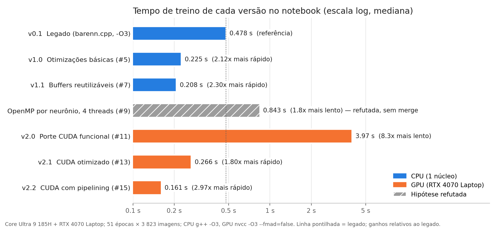

# Sumário executivo · Gabriel Galazzi

Relatório completo: [`report.md`](report.md) · versão em PDF: [`report.pdf`](report.pdf)

O treino da rede (64 → 32 → 16 → 10, SGD com uma amostra por passo, 51 épocas × 3 823 imagens) foi de **0.478 s no legado para 0.208 s na CPU (2.30x) e 0.161 s na GPU (2.97x)**, com a mesma acurácia (95.5%) em todas as versões. Cada degrau é um bloco lógico com Issue, branch, PR e tag anotada.



### Tabela consolidada

Tempo de treino, mediana de rodadas repetidas e intercaladas. CPU em um núcleo com `g++ -O3`; GPU com `nvcc -O3 --fmad=false`.

| Versão | Tag | Notebook (Core Ultra 9 / RTX 4070 Laptop) | Santos Dumont (Xeon 6252 / V100-SXM2) | Franky (i7-13700T / A1000 / V100-PCIE) | vs. legado (notebook) |
|:---|:---|---:|---:|---:|---:|
| Baseline legado | `v0.1-Baseline-Data` | 0.478 s | 0.925 s | 0.359 s | 1.00x |
| CPU otimizada, etapa 1 | `v1.0-Otimizacoe-Basicas-Aplicadas` | 0.225 s | 0.527 s | 0.217 s | 2.12x |
| **CPU otimizada** | `v1.1-Buffers-Reutilizaveis` | **0.208 s** | **0.492 s** | **0.201 s** | **2.30x** |
| CPU + OpenMP (refutada, sem merge) | – | 0.438 s (1 thr) · 0.843 s (4 thr) | 0.865 s (1 thr) | 0.436 s (1 thr) | mais lenta |
| **CUDA inicial** | `v2.0-CUDA-Funcional` | 3.968 s | 5.349 s | 4.149 s / 5.892 s | 8.3x mais lenta |
| **CUDA otimizado** | `v2.1-CUDA-Otimizado` | 0.266 s | 0.384 s | 0.356 s / 0.435 s | 1.80x |
| **CUDA otimizado + pipelining** | `v2.2-CUDA-Pipelining` | **0.161 s** | **0.267 s** | **0.215 s / 0.299 s** | **2.97x** |

Até `c1b2601` a saída é idêntica bit a bit à do legado. A redução por *shuffle* (Issue #13) muda a ordem das somas (perda de teste 0.0432 → 0.0434, acurácia igual), dentro do critério combinado na Issue. A `v2.2` é idêntica bit a bit à `v2.1`.

### Índice

| Bloco | Issue (diagnóstico e discussão) | PR | Tag |
|:---|:---|:---|:---|
| Automação do profiling e métrica base | [#1](https://github.com/GabrielGalazzi/awful-barenn-Gabriel-Galazzi/issues/1) | [#2](https://github.com/GabrielGalazzi/awful-barenn-Gabriel-Galazzi/pull/2), [#3](https://github.com/GabrielGalazzi/awful-barenn-Gabriel-Galazzi/pull/3), [#4](https://github.com/GabrielGalazzi/awful-barenn-Gabriel-Galazzi/pull/4) | [`v0.0-ferramenta-evaluate`](https://github.com/GabrielGalazzi/awful-barenn-Gabriel-Galazzi/tree/v0.0-ferramenta-evaluate), [`v0.1-Baseline-Data`](https://github.com/GabrielGalazzi/awful-barenn-Gabriel-Galazzi/tree/v0.1-Baseline-Data) |
| Otimizações básicas na CPU | [#5](https://github.com/GabrielGalazzi/awful-barenn-Gabriel-Galazzi/issues/5) | [#6](https://github.com/GabrielGalazzi/awful-barenn-Gabriel-Galazzi/pull/6) | [`v1.0-Otimizacoe-Basicas-Aplicadas`](https://github.com/GabrielGalazzi/awful-barenn-Gabriel-Galazzi/tree/v1.0-Otimizacoe-Basicas-Aplicadas) |
| Fim das alocações por amostra | [#7](https://github.com/GabrielGalazzi/awful-barenn-Gabriel-Galazzi/issues/7) | [#8](https://github.com/GabrielGalazzi/awful-barenn-Gabriel-Galazzi/pull/8) | [`v1.1-Buffers-Reutilizaveis`](https://github.com/GabrielGalazzi/awful-barenn-Gabriel-Galazzi/tree/v1.1-Buffers-Reutilizaveis) |
| OpenMP por neurônio (refutado) | [#9](https://github.com/GabrielGalazzi/awful-barenn-Gabriel-Galazzi/issues/9) | [#10](https://github.com/GabrielGalazzi/awful-barenn-Gabriel-Galazzi/pull/10) (sem merge) | – |
| Porte funcional para CUDA | [#11](https://github.com/GabrielGalazzi/awful-barenn-Gabriel-Galazzi/issues/11) | [#12](https://github.com/GabrielGalazzi/awful-barenn-Gabriel-Galazzi/pull/12) | [`v2.0-CUDA-Funcional`](https://github.com/GabrielGalazzi/awful-barenn-Gabriel-Galazzi/tree/v2.0-CUDA-Funcional) |
| Kernel persistente e memória compartilhada | [#13](https://github.com/GabrielGalazzi/awful-barenn-Gabriel-Galazzi/issues/13) | [#14](https://github.com/GabrielGalazzi/awful-barenn-Gabriel-Galazzi/pull/14) | [`v2.1-CUDA-Otimizado`](https://github.com/GabrielGalazzi/awful-barenn-Gabriel-Galazzi/tree/v2.1-CUDA-Otimizado) |
| Pipelining dentro do kernel | [#15](https://github.com/GabrielGalazzi/awful-barenn-Gabriel-Galazzi/issues/15) | [#16](https://github.com/GabrielGalazzi/awful-barenn-Gabriel-Galazzi/pull/16) | [`v2.2-CUDA-Pipelining`](https://github.com/GabrielGalazzi/awful-barenn-Gabriel-Galazzi/tree/v2.2-CUDA-Pipelining) |

### Principais conclusões

1. **CPU:** o ganho veio de deixar o compilador vetorizar (acesso linear e laços fundidos: −45% em `-O3`). O modelo (~11 KB) cabe na L1, então o código é limitado pelo núcleo, não pela memória.
2. **OpenMP:** cada barreira (0.1 a 1.7 µs) custa mais que o trabalho que divide (~0.15 µs). Refutado em três CPUs, de 8 a 48 núcleos.
3. **CUDA inicial:** 12 kernels por amostra deixam a GPU 18x mais lenta que a CPU. O tempo segue o clock da CPU que lança os kernels, não a GPU.
4. **CUDA otimizado:** um kernel persistente por época com os pesos na memória compartilhada (15x), mais *pipelining* entre etapas e amostras (1.65x). A GPU passa a CPU: 1.33x no notebook, 1.84x no Santos Dumont.
5. **Limite final:** ~8 M ciclos de SM por época em quatro GPUs de três arquiteturas. O tempo depende só do clock de um SM, por isso uma V100 perde para uma RTX A1000 e, num i9 a 5.5 GHz, a CPU ainda vence. Ir além exige minilotes, que mudariam o resultado.

### Reprodução

```bash
git checkout v2.2-CUDA-Pipelining
g++ -std=c++17 -O3 reusable_buffers_nn.cpp -o nn_cpu && taskset -c 1 ./nn_cpu
nvcc -O3 -std=c++17 -arch=sm_89 --fmad=false "Cuda versions/optimized_cuda_nn.cu" -o nn_gpu && ./nn_gpu
```

---

# Projeto Barenn: O Legado, a Sobrevivência e o Salto para a GPU

Era uma segunda-feira aparentemente tranquila quando a demanda chegou à sua mesa. A liderança técnica se aproximou com um sorriso contido e soltou aquela frase clássica que faz qualquer engenheiro gelar por dentro:

> "Temos um componente crítico rodando em produção há anos. O desenvolvedor original já saiu da empresa, mas agora o projeto é oficialmente seu."
    
Você procurou documentação, manuais ou notas de arquitetura e não encontrou rigorosamente nada. Restou apenas um código hermético a correr em produção.

Depois de analisar o código entendeu que é a implementação de uma Feedforward Neural Network, mas por que razão reinventar a roda? No passado, exigências estritas de conformidade e restrições de licenciamento impediram o recurso a bibliotecas de mercado. Sem alternativa, a empresa optou por criar a sua própria implementação de raiz. O resultado funcionou durante anos, mas tornou-se um labirinto técnico esquecido.

Com o aumento exponencial do volume de dados, a máquina atual começou a falhar nos prazos operacionais. Antes de qualquer migração complexa, **o seu primeiro desafio é estabilizar o código e espremer todo o desempenho possível da CPU — atacando gargalos, repensando o acesso à memória e explorando o paralelismo nativo.**

Para resolver o problema a longo prazo, a empresa adquiriu servidores blade equipados com GPUs corporativas NVIDIA. O hardware de alto desempenho já está montado no datacenter: **a sua missão final é reescrever os pontos críticos do algoritmo em CUDA e levar o processamento ao nível do paralelismo massivo.**

---

## Diretrizes de Conduta e Governança no Repositório

Neste projeto, o repositório não é apenas um local de entrega de arquivos, mas a **comprovação do seu processo investigativo de engenharia**. Espera-se uma postura estritamente empírica: nenhuma otimização deve ser feita no escuro e nenhuma melhoria de velocidade tem valor se corromper o resultado final do programa.

---

### O Princípio do Bloco Lógico de Trabalho

Você tem autonomia para decidir **o que** otimizar e **em qual ordem**, mas cada entrega deve ser estruturada como um **bloco lógico fechado**.

> **O que é um bloco lógico?**
> É uma unidade completa de intervenção técnica que engloba: **um problema identificado por profiling $\rightarrow$ uma hipótese de melhoria $\rightarrow$ a alteração no código $\rightarrow$ a validação da corretude $\rightarrow$ a medição do ganho real.**

* **Não crie tags por tempo decorrido:** Evite tags como `versao-dia-2` ou commits de "fim de expediente".
* **Não crie tags para alterações inconclusivas:** Se a alteração piorou o desempenho ou quebrou os testes, documente na Issue, reverta ou ajuste antes de formalizar o marco.
* **Toda tag deve ser reprodutível:** O professor ou qualquer colega deve conseguir executar `git checkout <tag>`, compilar o código e obter exatamente o mesmo comportamento e ordem de grandeza de desempenho documentados.

---

### O Fluxo Esperado no GitHub

Para cada intervenção técnica planejada, seu ciclo de trabalho no repositório deve seguir três pilares:

#### 1. Abertura de Issue (A Hipótese e o Ponto de Partida)

Antes de alterar uma única linha de código, abra uma Issue explicando a intenção do bloco lógico:

* **Diagnóstico:** Qual gargalo você encontrou usando ferramentas de análise (profilers)?
* **Hipótese:** Qual conceito técnico você pretende aplicar para resolver esse gargalo?
* **Métrica Base:** Qual é o tempo ou custo de processamento atual dessa rotina?

#### 2. Desenvolvimento Isolado e Commits Semânticos

* Trabalhe em uma *branch* dedicada àquela hipótese.
* Faça commits descritivos focados na causa da mudança (ex: `perf: ...`, `refactor: ...`, `fix: ...`).
* Certifique-se de que a saída do modelo/algoritmo continua correta. Código rápido que calcula resultados errados é considerado código quebrado.

#### 3. Formalização com Tag Anotada e Fechamento da Issue

Quando o bloco estiver concluído e validado, crie uma **Git Tag anotada**:

* A tag marca o estado exato da base de código naquele degrau de maturidade.
* A mensagem da tag deve resumir sucintamente o resultado alcançado.
* Feche a Issue anexando as evidências (dados de tempo, prints do profiler ou tabelas comparando o "antes e depois").

---

### Exemplo Ilustrativo de um Bloco Lógico

*(Este é apenas um exemplo de como organizar a narrativa técnica e as ferramentas; não representa um passo obrigatório ou a solução do seu problema).*

---

#### 1. Cenário: O aluno percebeu lentidão na etapa de processamento sequencial

* **Abertura da Issue #04:**
> **Título:** *Redução de tempo de computação na rotina de cálculo vetorial*
> **Contexto:** Ao inspecionar o código com o profiler, identificou-se que 65% do tempo de execução é consumido em um laço interno que realiza operações matemáticas repetitivas.
> **Métricas atuais:** Tempo total de execução: `14.2s`.
> **Hipótese:** Reestruturar a ordem dos dados para favorecer o uso de registradores e paralelizar o laço com múltiplos núcleos deve reduzir o tempo dessa rotina.


* **Implementação na branch:** `feature/otimizacao-laco-vetorial`
* Commits atômicos ajustando o laço e aplicando a estratégia escolhida.
* Verificação de que o resultado final do programa bate com o original.


* **Criação da Tag:**
```bash
git tag -a v0.3-laco-paralelo -m "Otimizacao do calculo vetorial: tempo reduzido de 14.2s para 4.8s (Speedup 2.95x). Corretude validada."
git push origin v0.3-laco-paralelo

```


* **Fechamento da Issue:**
* O aluno responde na Issue #04 anexando o comparativo de tempo (antes: `14.2s` / depois: `4.8s`), faz o merge da branch e referencia a tag criada:


> *"Otimização implementada e validada na tag `v0.3-laco-paralelo`. Issue fechada pelo PR #05."*


---

# Rubrica de Avaliação (Total: 10,0 Pontos)

<div style="background:rgba(255, 0, 0, 0.65)"> 

> ### ⚠️ CLÁUSULA ELIMINATÓRIA GERAL (CONDIÇÃO DE NOTA ZERO)
> 
> 
> A avaliação adota uma política estrita de controle de qualidade de engenharia:
> **Se em QUALQUER um dos critérios ou subcritérios de avaliação for observado o indicativo de `0,0 ponto`, a ATIVIDADE SERÁ INTEGRALMENTE ZERADA (Nota Final = 0,0).**
> Não é tolerada a ausência completa de qualquer pilar fundamental da atividade (seja por código inoperante/incorreto, falta de governança no Git ou ausência de embasamento empírico nas Issues).

* **Implementação e Desempenho Técnico:** 4,0 pontos
* **Governança, Reprodutibilidade e Tags:** 2,0 pontos
* **Relatório Técnico nas Issues (Análise e Discussão):** 4,0 pontos

</div>

---

### Critério 1: Implementação e Desempenho Técnico (4,0 pontos)

* **0,0 ponto [ZERA A ATIVIDADE]** — O código não compila, aborta durante a execução, não é funcional ou gera saídas matematicamente corrompidas.
* **+0,5 ponto** — Executou com sucesso o código legado, mediu o baseline de referência de forma reproduzível e identificou os gargalos iniciais.
* **+1,0 ponto** — Aplicou otimizações eficazes na CPU com ganhos consistentes de velocidade e paralelismo multicore preservando a integridade numérica.
* **+1,0 ponto** — **Migração Funcional para CUDA:** Porting inicial para GPU completo e correto (kernel funcional, alocação e liberação de memória no Device e transferências Host/Device íntegras).
* **+0,75 ponto** — Otimizou a execução em GPU.
* **+0,75 ponto** — Implementou técnicas avançadas em GPU, comprovando ganhos.

---

### Critério 2: Governança, Reprodutibilidade e Tags (2,0 pontos)

* **0,0 ponto [ZERA A ATIVIDADE]** — Ausência de tags, ou repositório com commit único ("tudo pronto") / commits lineares sem separação lógica, inviabilizando a reprodutibilidade dos marcos intermediários.
* **+0,5 ponto** — Utilizou tags, mas elas marcam datas/horários arbitrários em vez de blocos lógicos fechados de trabalho, ou as tags não compilam de forma independente.
* **+1,2 ponto** — Trabalho estruturado em **blocos lógicos**: cada intervenção possui uma Git Tag anotada associada a uma Issue, permitindo compilar e checar a métrica de cada versão via `git checkout <tag>`.
* **+2,0 pontos** — Reprodutibilidade e histórico impecáveis: commits atômicos com mensagens semânticas (`perf:`, `refactor:`, `test:`), branches limpas integradas via Pull Requests documentados e rastreabilidade total de cada degrau de performance.

---

### Critério 3: Relatório Técnico nas Issues (Análise e Discussão) (4,0 pontos)

#### 3.1 Profiling e Evidências Empíricas (1,5 ponto)

* **0,0 ponto [ZERA A ATIVIDADE]** — Não apresenta dados de medição nas Issues ou baseia-se unicamente em impressões subjetivas sem qualquer dado empírico.
* **+0,5 ponto** — Apresenta apenas tempos brutos de relógio (*wall-clock*) colados em texto corrido, sem dados de profilers ou repetições estatísticas.
* **+1,0 ponto** — Apresenta dados e capturas das ferramentas oficiais (**perf/callgrind** e **Nsight Systems/Compute**), mas faltam informações cruciais de ambiente (flags, parâmetros de teste ou hardware).
* **+1,5 ponto** — Issues contêm relatórios completos de profiling (CPU e GPU), métricas de hardware detalhadas (tempo de kernel vs transferência PCIe, cache misses, ocupação teórica vs real de SMs) e metodologia experimental rigorosa.

#### 3.2 Qualidade da Discussão Técnica e Argumentação de Engenharia (2,5 pontos)

* **0,0 ponto [ZERA A ATIVIDADE]** — Discussão inexistente, Issues fechadas apenas com "ok/concluído" ou explicações inconsistentes/conflitantes com os dados coletados.
* **+1,0 ponto** — Discussão puramente descritiva (lista o que foi alterado nas linhas de código, mas não analisa *por que* houve ou não ganho com base em hardware).
* **+1,8 ponto** — Discute tecnicamente a relação entre o código e o comportamento de hardware (ex: impacto do layout de memória nos caches da CPU, balanceamento de carga entre threads).
* **+2,5 pontos** — Análise técnica aprofundada: correlaciona os resultados com conceitos avançados de arquitetura (roofline model, limites da Lei de Amdahl, latência do PCIe vs throughput do kernel CUDA) e debate criticamente as decisões de engenharia tomadas.

---

## Tabela de Cenários e Balizadores

| Cenário | Situação Técnica no GitHub | Resultado / Nota |
| --- | --- | --- |
| **Desclassificado** | Tirou `0,0` em qualquer critério (ex: código não compila, sem tags, sem dados de profiling nas issues ou issues vazias). | **0,0 (Zerada)** |
| **Abaixo do Esperado** | Código compila e funciona, mas há otimizações superficiais, profiling fraco e tags incompletas. | **0,1 a 5,9** |
| **Linha de Base (Alvo: 6,0)** | CPU razoavelmente otimizada + **Migração simples para CUDA funcional** + Issues estruturadas com diagnóstico e tags atreladas. | **6,0 a 6,5** |
| **Avançado / Destaque** | CPU altamente eficiente + **CUDA com otimizações avançadas (Shared Memory/Streams)** + discussões ricas nas Issues com Nsight/Perf + governança impecável. | **8,5 a 10,0** |

---

## Formato de Entrega

A entrega consiste exclusivamente no **link do repositório no GitHub**.

1. O `README.md` principal deve atuar como o **sumário executivo do relatório**, sendo adiciocionado **NO TOPO DO README**:
* A tabela consolidada final comparando todas as versões (Baseline Legado, CPU Otimizada, CUDA Inicial, CUDA Otimizado);
* Um **índice navegável com links diretos** para cada uma das Issues/Tags que contêm a discussão detalhada;

2. Todas as branches de trabalho devem estar integradas à `main`;
3. Todas as Issues de experimentos devem estar fechadas e associadas à sua respectiva Git Tag anotada.
