# Projeto Barenn: do código legado à GPU

**Relatório técnico consolidado da APS 2 de Supercomputação (Insper)**
Autor: Gabriel Galazzi · Repositório: [`GabrielGalazzi/awful-barenn-Gabriel-Galazzi`](https://github.com/GabrielGalazzi/awful-barenn-Gabriel-Galazzi) · Período: 27/10/2026 a 26/11/2026

---

## Sumário

1. [Resumo](#1-resumo)
2. [O ponto de partida](#2-o-ponto-de-partida)
3. [Como medi: ambientes e método](#3-como-medi-ambientes-e-método)
4. [Linha do tempo do trabalho](#4-linha-do-tempo-do-trabalho)
5. [Etapa 0 · A ferramenta e a métrica base (Issue #1)](#5-etapa-0--a-ferramenta-e-a-métrica-base-issue-1)
6. [Etapa 1 · Otimizações básicas na CPU (Issue #5)](#6-etapa-1--otimizações-básicas-na-cpu-issue-5)
7. [Etapa 2 · Fim das alocações por amostra (Issue #7)](#7-etapa-2--fim-das-alocações-por-amostra-issue-7)
8. [Etapa 3 · OpenMP por neurônio: uma hipótese refutada (Issue #9)](#8-etapa-3--openmp-por-neurônio-uma-hipótese-refutada-issue-9)
9. [Etapa 4 · Porte funcional para CUDA (Issue #11)](#9-etapa-4--porte-funcional-para-cuda-issue-11)
10. [Etapa 5 · Otimização da execução em GPU (Issue #13)](#10-etapa-5--otimização-da-execução-em-gpu-issue-13)
11. [Etapa 6 · Pipelining dentro do kernel (Issue #15)](#11-etapa-6--pipelining-dentro-do-kernel-issue-15)
12. [Reprodução em cinco máquinas](#12-reprodução-em-cinco-máquinas)
13. [Conclusões](#13-conclusões)
14. [Apêndice: índice, tags e reprodução](#14-apêndice-índice-tags-e-reprodução)

---

## 1. Resumo

Recebi um componente legado, sem documentação, que treina uma rede neural *feedforward* (64 → 32 → 16 → 10, ReLU, SGD com uma amostra por passo) sobre o conjunto `optdigits`: 3 823 imagens de treino, 51 épocas, 194 973 passos de treino ao todo, e 1 797 imagens de teste. A missão tinha duas metades: espremer a CPU e depois levar o treino para a GPU, **sem nunca mudar o resultado do modelo**.

O trabalho foi dividido em sete blocos lógicos, cada um com Issue (diagnóstico, hipótese e métrica base), branch própria, commits semânticos, Pull Request e tag anotada. Seis blocos foram integrados à `master`; um (OpenMP) foi refutado pelos dados e ficou documentado, sem merge.

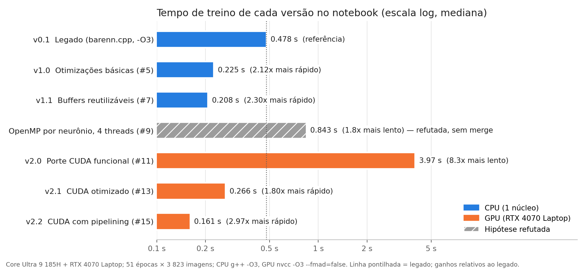

**Tabela consolidada** (tempo de treino, mediana de rodadas repetidas e intercaladas; CPU em um núcleo com `g++ -O3`, GPU com `nvcc -O3 --fmad=false`):

| Versão | Tag | Notebook (Core Ultra 9 185H / RTX 4070 Laptop) | Santos Dumont (Xeon Gold 6252 / V100-SXM2) | Franky (i7-13700T / RTX A1000 / V100-PCIE) | Ganho sobre o legado (notebook) |
|:---|:---|---:|---:|---:|---:|
| Baseline legado | `v0.1-Baseline-Data` | 0.478 s | 0.925 s | 0.359 s | 1.00x |
| CPU, otimizações básicas | `v1.0-Otimizacoe-Basicas-Aplicadas` | 0.225 s | 0.527 s | 0.217 s | 2.12x |
| **CPU otimizada** (buffers reutilizáveis) | `v1.1-Buffers-Reutilizaveis` | **0.208 s** | **0.492 s** | **0.201 s** | **2.30x** |
| CPU + OpenMP por neurônio (refutada) | sem tag | 0.438 s (1 thr) · 0.843 s (4 thr) | 0.865 s (1 thr) · 15.5 s (48 thr) | 0.436 s (1 thr) · 14.2 s (8 thr) | mais lenta |
| **CUDA inicial** (porte 1:1) | `v2.0-CUDA-Funcional` | 3.968 s | 5.349 s | 4.149 s / 5.892 s | 8.3x mais lenta |
| **CUDA otimizado** (kernel persistente) | `v2.1-CUDA-Otimizado` | 0.266 s | 0.384 s | 0.356 s / 0.435 s | 1.80x |
| **CUDA otimizado + pipelining** | `v2.2-CUDA-Pipelining` | **0.161 s** | **0.267 s** | **0.215 s / 0.299 s** | **2.97x** |

Em todas as versões integradas, a acurácia de teste é **95.5% (1 717 de 1 797)**. Até `c1b2601` a saída impressa é idêntica bit a bit à do legado; a partir da redução por *shuffle* (Issue #13) a ordem das somas muda e a perda de teste passa de 0.0432 para 0.0434, dentro do critério combinado antes da mudança. A `v2.2` é idêntica bit a bit à `v2.1`.

**As cinco conclusões que mais importam:**

1. **Na CPU, o que rendeu foi deixar o compilador vetorizar.** Linearizar o acesso à memória e fundir laços (−45% em `-O3`) valeu mais que todas as outras mudanças juntas. O modelo inteiro (~11 KB) cabe na L1, então o código é limitado pelo núcleo, não pela memória.
2. **Paralelismo só se paga quando o trabalho entre sincronizações supera o custo delas.** No OpenMP, cada barreira (0.1 a 1.7 µs) custava mais que o trabalho que dividia (~0.15 µs). Isso valeu nas três CPUs testadas, de 8 a 48 núcleos.
3. **O porte 1:1 para CUDA era limitado por lançamento de kernel, não por cálculo.** 12 kernels por amostra deixaram a GPU 18x mais lenta que a CPU, e o tempo acompanhava o clock da CPU que lançava os kernels, não a GPU.
4. **Fundir tudo num kernel persistente, com os pesos na memória compartilhada, trouxe 15x.** O *pipelining* entre etapas e amostras trouxe mais 1.65x, e a GPU passou a CPU pela primeira vez (1.33x no notebook, 1.84x no Santos Dumont).
5. **A versão final é limitada pelo clock de um único SM.** Ela precisa de ~8 milhões de ciclos por época em quatro GPUs de três arquiteturas. Por isso uma V100 com 80 SMs perde para uma RTX A1000 com 18, e quem vence a disputa CPU × GPU é decidido pela CPU do nó. Ir além exigiria mudar o algoritmo (minilotes), o que mudaria o resultado e ficou fora do escopo.

---

## 2. O ponto de partida

O código chegou em três commits do professor (27/10/2026): um protótipo (`60c9104`) que lia um arquivo de 296 bytes, o README do desafio e a versão "pronta para produção" `barenn.cpp` (`06cee91`). Não havia documentação além do próprio código.

Lendo o código, a estrutura era simples: uma classe `DenseLayer` com `Forward` e `Backward`, pesos em `vector<vector<float>>`, imagens em `vector<float>` separados, e um laço de treino que, para cada amostra, faz o `Forward` das três camadas, calcula a perda e faz o `Backward`, atualizando os pesos imediatamente (SGD puro). Esse detalhe do algoritmo, **a amostra `k+1` depende dos pesos que a amostra `k` acabou de escrever**, acabou definindo tudo o que era e o que não era possível paralelizar ao longo do projeto.

A regra de ouro, imposta pelo enunciado, foi tratada com rigor desde o início: código rápido que calcula outra coisa é código quebrado. Por isso cada etapa compara a **saída inteira** do programa (perdas de todas as épocas, acurácia, matriz de confusão, inferências), não apenas a acurácia.

---

## 3. Como medi: ambientes e método

### Máquinas

| Ambiente | CPU | GPU | Compiladores |
|:---|:---|:---|:---|
| Notebook (principal) | Intel Core Ultra 9 185H, P-core até 5.1 GHz, L1d 48 KB, L2 2 MB | RTX 4070 Laptop (Ada, `sm_89`, 36 SMs, 1.98/2.56 GHz) | g++ 11.4, CUDA 13.2 |
| Santos Dumont (LNCC) | 2× Xeon Gold 6252 (Cascade Lake, 48 núcleos, 3.7 GHz) | Tesla V100-SXM2 32 GB (Volta, `sm_70`, 80 SMs, 1530 MHz) | GCC 11.1, CUDA 12.6 |
| Franky (Insper), `pluton_cpu` | i7-13700T (Raptor Lake, P-core 4.8 GHz) | – | GCC 11.5 e 14.2 |
| Franky, `pluton_gpu` | i9-14900 (5.5 GHz) | RTX A1000 (Ampere, `sm_86`, 18 SMs, ~1875 MHz) | CUDA 12.8 |
| Franky, `monstrao` | Xeon Gold 5215 (3.1 GHz) | Tesla V100-PCIE 32 GB (Volta, 80 SMs, 1380 MHz) | CUDA 12.8 |

### Método

- **Métrica:** o tempo de treino que o próprio programa imprime (só o laço de treino das 51 épocas). O tempo total do processo também foi registrado, mas inclui leitura de arquivos e criação do contexto CUDA.
- **Rodadas intercaladas:** em cada rodada, todas as versões rodam uma vez, em ordem sorteada, depois de um aquecimento não registrado. Assim, aquecimento térmico e carga de fundo atingem todas as versões por igual. No notebook usei de 10 a 100 rodadas por comparação, com o processo fixo num P-core (`taskset`); nos clusters, nós exclusivos e de 6 a 40 rodadas.
- **Estatística:** mediana, desvio padrão, diferença pareada com intervalo de confiança de 95% (bootstrap) e teste do sinal quando a diferença era pequena.
- **Corretude:** hash SHA-256 da saída inteira, sem as linhas de tempo. A referência (`d6046538f58a`) é a mesma no notebook, no Santos Dumont e no Franky, e as saídas CUDA são idênticas entre `sm_70`, `sm_86` e `sm_89`. Nas versões CUDA, também `compute-sanitizer` (`memcheck`, `racecheck`, `synccheck`).
- **Profilers:** callgrind/KCachegrind (com simulação de cache ajustada ao P-core), `perf stat`/`perf annotate` (Santos Dumont), contadores próprios via `perf_event_open` (Franky, onde não há `perf`), `strace`, `-fopt-info-vec`, assembly, Nsight Systems, Nsight Compute, `cuobjdump`/`ptxas -v` e cronometragem dentro do kernel com `clock64()`.
- **Uma limitação que acompanhou quase todo o projeto:** o Nsight Compute (`ncu`) retornou `ERR_NVGPUCTRPERM` nas três máquinas com GPU, porque os contadores de desempenho da GPU são restritos a administradores (`RmProfilingAdminOnly: 1`). Durante os blocos, a ocupação e os conflitos de banco foram calculados (`ptxas`, configuração de lançamento) e localizados por ablação e contagem de ciclos. No fim, o `ncu` foi executado com `sudo` no notebook (Nsight Compute 2026.1.1, `--set full`) sobre `v2.0`, `v2.1` e `v2.2`, e as medidas diretas (ocupação alcançada, motivos de espera dos warps, conflitos de banco) confirmaram os cálculos; elas estão nas Etapas 4, 5 e 6. No Santos Dumont e no Franky ele continua bloqueado.
- **`-Ofast` e `--use_fast_math` ficaram fora** das comparações oficiais: eles mudam a saída (1 716 acertos em vez de 1 717 no legado).

---

## 4. Linha do tempo do trabalho

Horários de Brasília, tirados das Issues, PRs e commits.

| Data | Marco | Issue / PR | Tag |
|:---|:---|:---|:---|
| 27/10 | Código legado entregue (`60c9104`, `06cee91`) | – | – |
| 14/11, 17:04 → 17:17 | Ferramenta `evaluate` para automatizar o profiling | [#1](https://github.com/GabrielGalazzi/awful-barenn-Gabriel-Galazzi/issues/1), PRs #2, #3 (revert), #4 | `v0.0-ferramenta-evaluate` |
| 14/11, 19:24 | Métrica base registrada (`2d2597f`) | – | `v0.1-Baseline-Data` |
| 14/11, 19:40 → 21:10 | Quatro otimizações básicas, um commit cada | [#5](https://github.com/GabrielGalazzi/awful-barenn-Gabriel-Galazzi/issues/5), PR #6 | `v1.0-Otimizacoe-Basicas-Aplicadas` |
| 15/11, 13:38 → 14:36 | Buffers reutilizáveis e pesos contínuos | [#7](https://github.com/GabrielGalazzi/awful-barenn-Gabriel-Galazzi/issues/7), PR #8 | `v1.1-Buffers-Reutilizaveis` |
| 25/11, 19:03 → 19:26 | OpenMP por neurônio, **refutado** | [#9](https://github.com/GabrielGalazzi/awful-barenn-Gabriel-Galazzi/issues/9), PR #10 fechado sem merge | – |
| 25/11, 21:53 → 22:24 | Porte funcional para CUDA | [#11](https://github.com/GabrielGalazzi/awful-barenn-Gabriel-Galazzi/issues/11), PR #12 | `v2.0-CUDA-Funcional` |
| 26/11, 11:32 → 12:07 | Kernel persistente, memória compartilhada, *shuffles* | [#13](https://github.com/GabrielGalazzi/awful-barenn-Gabriel-Galazzi/issues/13), PR #14 | `v2.1-CUDA-Otimizado` |
| 26/11, 14:22 → 14:48 | *Pipelining* dentro do kernel | [#15](https://github.com/GabrielGalazzi/awful-barenn-Gabriel-Galazzi/issues/15), PR #16 | `v2.2-CUDA-Pipelining` |
| 26/11, tarde e noite | Todos os commits reexecutados no Santos Dumont e no Franky; resultados anexados às Issues | #1 a #15 | – |
| 27/11 | Nsight Compute com `sudo` sobre `v2.0`, `v2.1` e `v2.2`; ocupação real e motivos de espera anexados às Issues | #11, #13, #15 | – |

Cada bloco seguiu o mesmo ciclo: perfil → hipótese escrita na Issue antes do código → commits isolados → validação da saída → medição repetida → fechamento com evidências e tag. O espaçamento entre 15/11 e 25/11 marca a virada da fase de CPU para a de paralelismo e GPU.

---

## 5. Etapa 0 · A ferramenta e a métrica base (Issue #1)

**O problema.** Cada hipótese precisaria ser medida do mesmo jeito em três ambientes, em cinco níveis de otimização, conferindo a saída e, às vezes, sob callgrind ou Nsight Systems. Feito à mão, isso levava ~30 minutos por versão e era fácil de errar (anotar a execução errada, esquecer a flag, comparar saídas de rodadas diferentes).

**O que foi feito.** O script `evaluate` compila o arquivo em todos os níveis (serial, OpenMP ou CUDA), roda cada binário, extrai tempo e acurácia, compara a saída com a do nível sem otimização e registra o ambiente (CPU, GPU, compilador, revisão do git) no relatório. Opcionalmente roda callgrind e Nsight Systems e guarda os perfis brutos.

**Resultado.** A rotina de ~30 min passou a rodar sozinha em ~8 min. O callgrind do nível sem otimização deu 130.49 bilhões de instruções, o mesmo valor do perfil manual.

O episódio dos PRs #2 a #4 (merge, revert por falta de mensagem de merge, restauração) ficou registrado no histórico de propósito: o histórico não foi reescrito.

**O que a ferramenta ensinou logo de cara:**

- A comparação automática de saída pegou na primeira execução que **`-Ofast` muda o resultado** (1 716 acertos em vez de 1 717), e esse nível saiu das comparações.
- **Uma execução por nível não basta.** O ruído no notebook ficou em ~1.5%, maior que alguns ganhos reais. A partir daí, o `evaluate` virou ferramenta de triagem, e as comparações oficiais passaram a usar rodadas repetidas e intercaladas.

**Métrica base do legado (`06cee91`):**

| Nível | Notebook | Santos Dumont | Franky (i7-13700T) |
|:---|---:|---:|---:|
| sem flag / `-O0` | 5.876 s | 12.65 s | 5.422 s |
| `-O2` | 0.683 s | 1.246 s | 0.578 s |
| `-O3` | 0.452 s (0.478 s em 50 rodadas) | 0.925 s | 0.359 s |
| `-O3 -march=native` | – | 2.396 s (saída diferente) | 0.389 s |

Só compilar com `-O3` já dá 13x a 15x sobre `-O0`; todas as versões seguintes partem desse ganho.

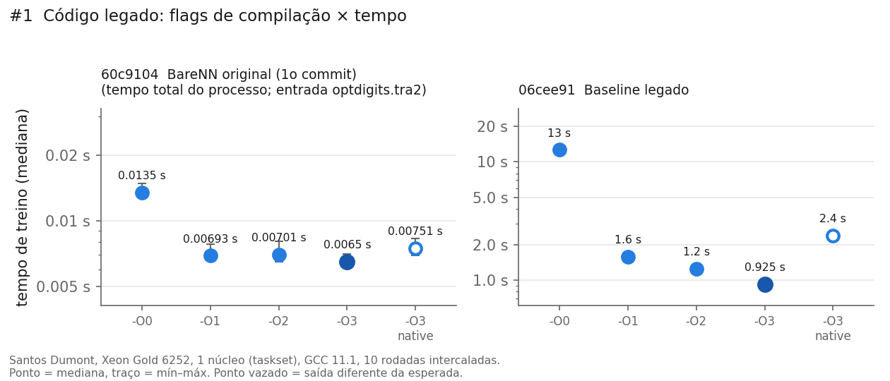

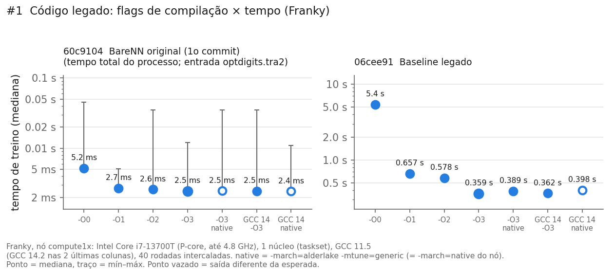

Os gráficos mostram a mesma forma de curva nas três máquinas, com uma surpresa: **`-march=native` deixa o legado mais lento** (2.6x no Xeon, 8.5% no Raptor Lake). A explicação, diferente em cada máquina, está na Etapa 1.

---

## 6. Etapa 1 · Otimizações básicas na CPU (Issue #5)

### Diagnóstico

O callgrind da versão base (`-O2 -g`) mostrou que **`Backward` consome 69.6% das instruções e `Forward` 24.8%**, com ~2.9 milhões de chamadas a `malloc`/`free` (13 alocações por amostra).

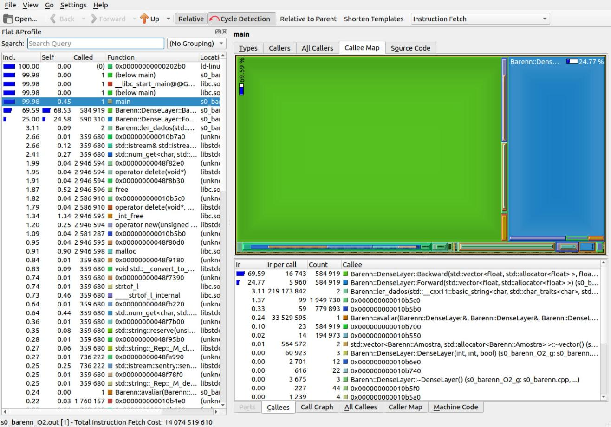

Lendo o código com o perfil em mãos, apareceram cinco problemas: vetores passados por cópia; o gradiente da entrada lendo a matriz por coluna, pulando entre linhas alocadas separadamente (o GCC recusa vetorizar: *not suitable for gather load*); dois laços que percorriam a mesma matriz; um gradiente calculado na camada 1 que ninguém usava; e cada imagem num `vector` próprio.

Um dado decisivo veio da simulação de cache: **a taxa de falhas na L1d era de 0.02%**. Os ~2 800 parâmetros (~11 KB) cabem inteiros na L1. Portanto o gargalo não era memória, e sim a quantidade e o tipo de instruções.

### Hipótese e resultado

Corrigir um problema por commit, medindo cada um (50 rodadas intercaladas, P-core fixo, IC 95% por bootstrap):

| Etapa | `-O2` | Variação | `-O3` | Variação | Instruções/amostra (`-O3`) |
|:---|---:|---:|---:|---:|---:|
| Base (`barenn.cpp`) | 0.726 s | | 0.478 s | | 46.4 mil |
| 1. Passagem por `const&` (`5c32605`) | 0.651 s | −10.4% | 0.459 s | −4.0% | 46.0 mil |
| 2. Acesso linear + laços fundidos (`7df40af`) | 0.582 s | −10.6% | 0.250 s | **−45.5%** | 27.1 mil |
| 3. Sem gradiente da camada 1 (`cf4fc4e`) | 0.514 s | −11.7% | 0.228 s | −8.7% | 23.4 mil |
| 4. Amostras em bloco contínuo (`909beb4`) | 0.506 s | −1.4% | 0.225 s | −1.5% | 23.4 mil |
| **Total** | **1.43x** | | **2.12x** | | |

Todas as 500 execuções deram saída idêntica à da base, e todas as etapas são estatisticamente significativas.

### Por que cada etapa rendeu o que rendeu

- **A etapa 2 é a que importa.** Andando pela matriz por linha, o gradiente e a atualização usam a mesma leitura de cada peso, e em `-O3` o GCC passa a vetorizar o laço com SSE (*loop vectorized using 16 byte vectors*): as instruções por amostra caem 41%. Em `-O2` o GCC 11 não vetoriza, e o ganho fica em 10.6%.
- **A etapa 1 economizou trabalho de memória, não instruções:** −10% de tempo para −1% de instruções em `-O2`.
- **A etapa 4 rendeu pouco, como previsto:** as falhas de L1 por amostra caem de 4.85 para 4.13, mas os dados de treino (~1 MB) já cabiam na L2 e eram lidos quase em sequência.

### Roofline

Depois da etapa 3, cada amostra custa ~15.1 mil FLOPs, o que dá ~13 GFLOP/s em `-O3` (a base fazia ~8). A única coisa que vem de fora da L1 a cada amostra é a imagem (~4 linhas de cache, exatamente as ~4.1 falhas medidas), o que dá ~57 FLOP por byte: muito à direita do ponto de inflexão do roofline. O código é limitado pelo núcleo. Ainda estamos em 20–30% do teto de um P-core com SSE, porque sem `-ffast-math` as somas do produto escalar ficam em cadeia (`addss` uma a uma) e os laços são curtos.

### Reprodução e a armadilha do `-march=native`

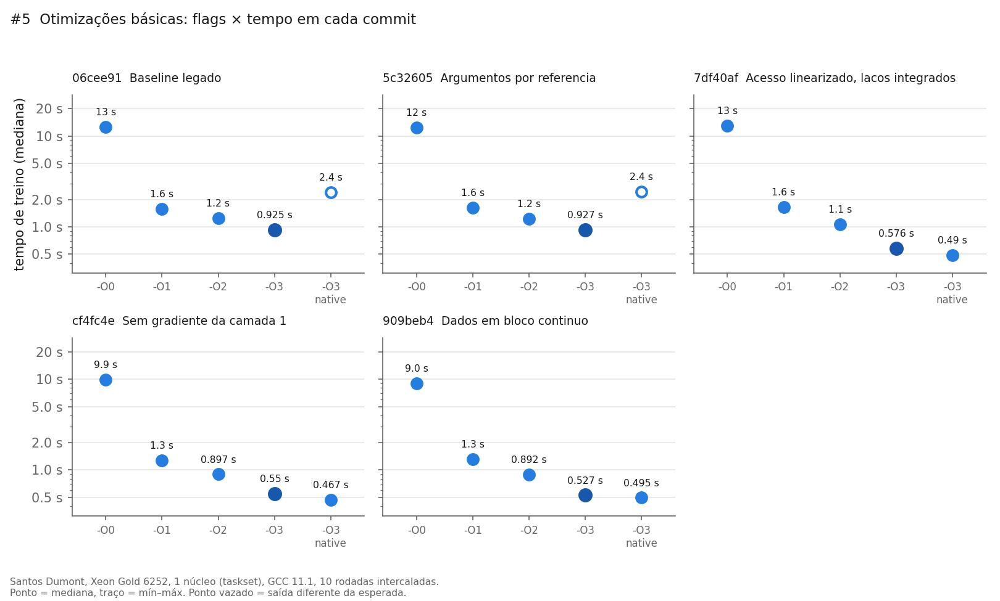

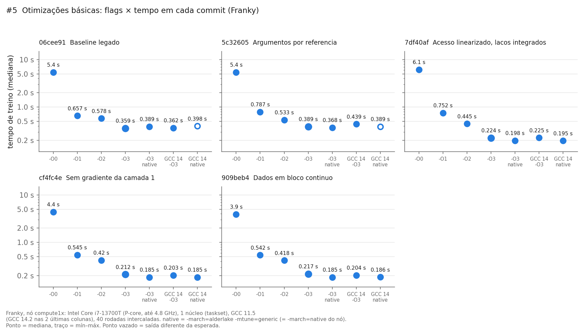

A linearização é o passo decisivo nas três máquinas (−38% a −50%). O `perf` no Xeon confirmou com hardware real o que o callgrind simulou: as operações FP escalares caem de 1.64 G para 0.58 G e as vetoriais sobem de 0.53 G para 0.79 G.

O `-march=native` contou duas histórias diferentes:

- **No Xeon (Cascade Lake), o legado fica 2.6x mais lento** por causa de instruções *gather* do AVX-512 (`vgatherqps`): o GCC passou a "vetorizar" o percurso por colunas de `vector<vector<float>>` buscando cada elemento numa linha diferente. Resultado: 13x mais ciclos parados esperando memória.
- **No Raptor Lake, o legado fica 8.5% mais lento por causa da FMA.** O AVX2 sozinho ajuda (−4.2%), mas a contração em FMA alonga a cadeia de dependência das somas, porque nessa microarquitetura a soma FP tem latência menor que a FMA.

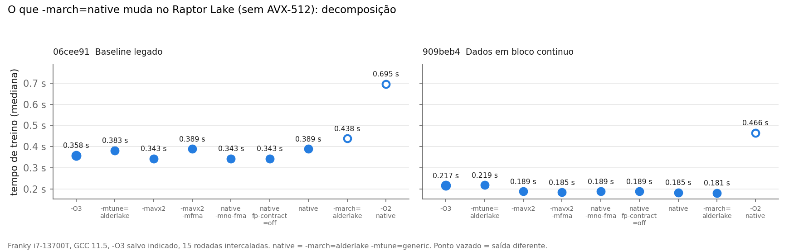

A partir da linearização, o acesso é contínuo e `-march=native` passa a ajudar (6% a 15%). **Lição:** o layout de memória decide quais instruções o compilador pode usar, e uma flag "mais agressiva" precisa ser medida em cada CPU. Por mudar a saída e depender da máquina, `-march` ficou fora das comparações oficiais.

---

## 7. Etapa 2 · Fim das alocações por amostra (Issue #7)

### Diagnóstico e hipótese

A `v1.0` ainda criava 8 vetores novos por amostra (`out`, `delta`, `grad_in`): o callgrind contou 8.0 chamadas a `operator new` por amostra. A hipótese era alocá-los uma vez no construtor e reutilizá-los, aproveitando para guardar os pesos num bloco contínuo. A expectativa declarada era **modesta**, porque o tcache da glibc torna cada `malloc`/`free` barato e o modelo já cabia na L1.

### Resultado (100 rodadas pareadas)

| Nível | v1.0 | v1.1 | Variação | v1.1 mais rápida em |
|:---|---:|---:|---:|---:|
| `-O0` | 4.471 s | 2.954 s | −33.9% | 100/100 |
| `-O2` | 0.499 s | 0.495 s | −0.8% (não significativo) | 50/100 |
| `-O3` | 0.221 s | **0.208 s** | **−5.9%** | 100/100 |

Em `-O3` o ganho acompanha a redução de instruções (−4.9%); as falhas de L1 não mudaram. Atribuindo o ganho às alocações, cada par `malloc`/`free` custava ~8 ns, compatível com o caminho rápido do tcache.

### O mistério do `-O2`

Em `-O2` o programa executava 9% menos instruções e **não ficou mais rápido**. O assembly explicou: com `delta` e `grad_in` virando membros da classe, o compilador não consegue mais provar que escrever em `grad_in[j]` não altera `delta[i]` (*aliasing*), e passou a reler `delta[i]` da memória duas vezes por iteração no laço mais quente. Uma variante com `const float d = delta[i];` recuperou o ganho (−3.5% em `-O2`, −7.7% em `-O3`). **Contar instruções não basta; é preciso olhar o laço crítico.**

No Xeon, porém, a mesma v1.1 ganhou 7.6% em `-O2`. Mesmo código, mesmo compilador: a diferença está no núcleo (hipótese não medida: *store forwarding* mais barato no Cascade Lake). Um resultado "nulo" pode depender da máquina.

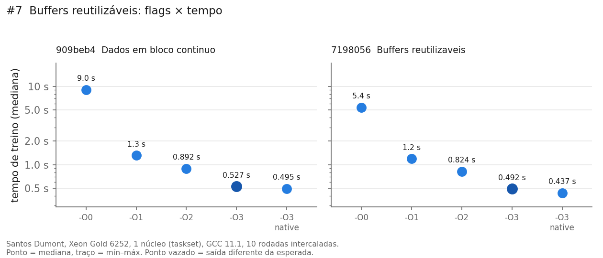

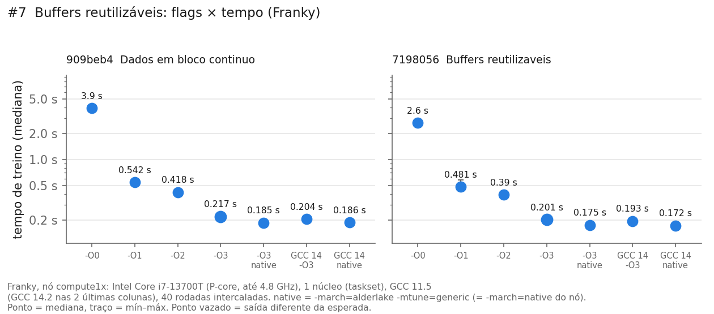

O ganho em `-O3` é o mesmo nas três máquinas (−5.9% a −7.5%), e os contadores mostram que ele vem de instruções a menos, não de falhas de cache. **A `v1.1` é a melhor versão de CPU do projeto**: 2.30x mais rápida que o legado no notebook.

---

## 8. Etapa 3 · OpenMP por neurônio: uma hipótese refutada (Issue #9)

### A aposta

Depois das etapas anteriores, **98.6% das instruções do treino estavam nos laços de neurônios**. O SGD impede paralelizar entre amostras, mas dentro de uma camada os neurônios são independentes. A ideia: uma região paralela em volta do treino, `omp for` dentro de `Forward` e `Backward`, mantendo a ordem das somas para preservar a saída bit a bit. Amdahl prometia até 5.6x com 6 P-cores.

A própria Issue registrou o risco antes de qualquer código: cada amostra levava ~1.1 µs e passaria a ter 9 barreiras, ou seja, ~120 ns de trabalho entre duas sincronizações.

### O que aconteceu

A saída ficou idêntica com qualquer número de threads, mas **o desempenho piorou em todas as configurações**:

| Configuração (notebook, `-O3`) | Threads | Mediana | vs. v1.1 |
|:---|:---:|---:|---:|
| v1.1 serial | 1 | 0.216 s | – |
| Código paralelo sem `-fopenmp` | 1 | 0.259 s | +19.5% |
| OpenMP | 1 | 0.438 s | +102% |
| OpenMP | 4 | 0.843 s | +290% |
| OpenMP | 16 | 2.988 s | +1 282% |

### Por quê

- **O custo da barreira supera o trabalho que ela divide.** Modelando T(p) = T_serial + T_paralelo/p + N·c(p), com N ≈ 1.75 milhão de barreiras, o custo por barreira vai de 0.10 µs (1 thread) a 1.69 µs (16 threads), contra ~0.15 µs de trabalho útil entre barreiras.
- **Uma chamada ao kernel por barreira.** O `strace` contou 1 754 810 `futex` por execução, exatamente uma por barreira, mesmo com 1 thread. O callgrind não enxerga esse tempo: `GOMP_barrier` aparece com só 1.5% das instruções.

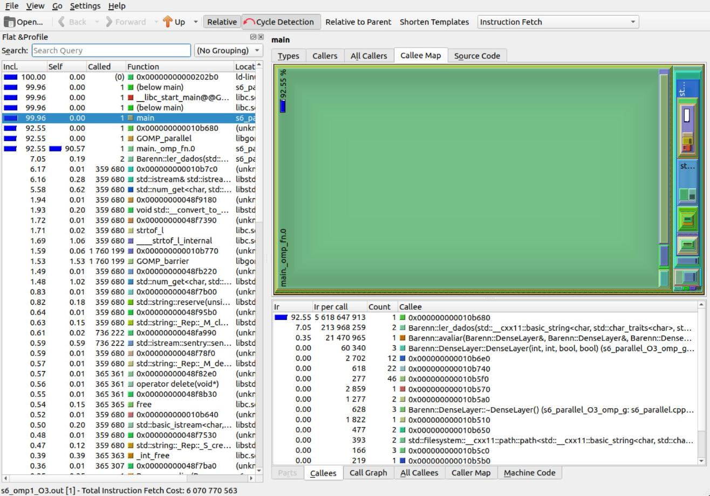

- **Coerência de cache.** Contadores, buffers compartilhados e o contador da barreira migram entre as L1 a cada etapa.
- **A reestruturação também custou:** o `Backward` passou a ter duas passadas e perdeu a vetorização (+19.5% sem threads).

### Confirmação em 48 núcleos e em outra microarquitetura

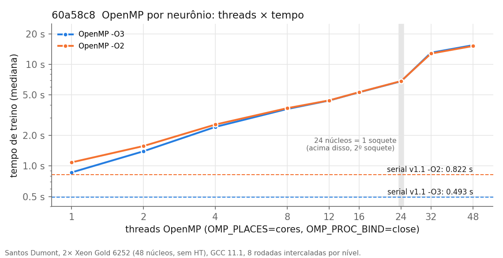

No Santos Dumont, 48 threads deixam o treino **31x mais lento** que o serial. O `perf` mostrou a coerência diretamente: de 1 para 8 threads, as leituras HITM (linha modificada no cache de outro núcleo) vão de 913 para 79 milhões, e o IPC cai de 2.12 para 0.03. O salto entre 24 e 32 threads é o segundo soquete: os HITM vindos do outro soquete saltam 550x, porque a barreira passa a atravessar o link UPI.

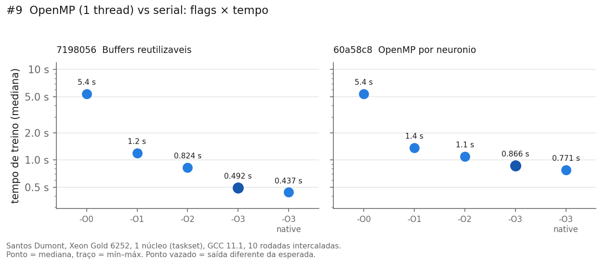

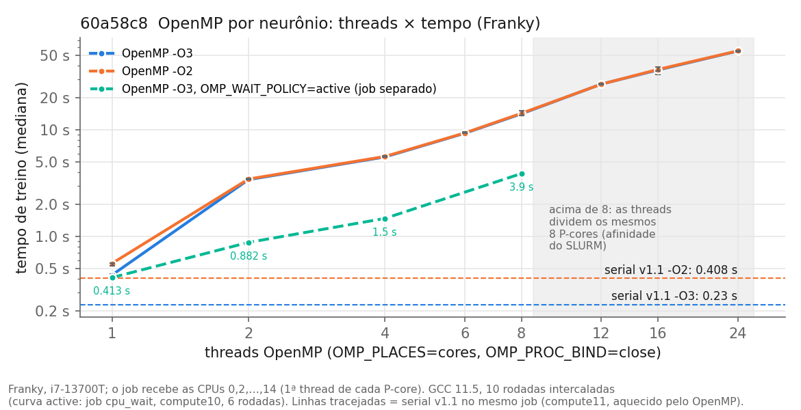

No Franky a curva foi ~4x pior, e o motivo foi isolado: lá, o libgomp padrão se comporta como `passive` (as threads dormem em cada barreira). Com `OMP_WAIT_POLICY=active`, o custo cai 3.7x, mas 8 threads continuam 18.7x mais lentas que o serial.

**Conclusão.** A hipótese foi refutada nas três CPUs, e a decisão de não fazer merge (nem tag) é coerente com os dados; a branch ficou como registro. A lição atravessou o resto do projeto: **o limite não é o cálculo, é a granularidade da sincronização**. Um microbenchmark no Nsight Systems, feito ainda nessa Issue, já mostrava o mesmo problema na GPU: 2.1 µs por `cudaLaunchKernel` e 2.7 µs por kernel, contra 1.1 µs por amostra inteira na CPU.

---

## 9. Etapa 4 · Porte funcional para CUDA (Issue #11)

### Objetivo: correto antes de rápido

Este bloco declarou de antemão que o porte seria **mais lento que a CPU**. O objetivo era ter uma base correta e medida. Cada laço da CPU virou um kernel, com uma thread por unidade de trabalho (`forward`, `loss`, `delta`, `grad_input`, `update`): 12 kernels por amostra, ~2.34 milhões no treino. Dados e pesos iniciais vão para a GPU uma única vez; não há nenhuma transferência durante o treino. Toda chamada da API é verificada, e cada `cudaMalloc` tem seu `cudaFree` garantido por RAII.

A previsão escrita na Issue foi "da ordem de 5 s, ~20x a CPU".

### Resultado

| Versão (notebook) | Tempo de treino | Relação com a CPU | Saída |
|:---|---:|:---:|:---|
| CPU `v1.1`, `-O3` | 0.220 s | 1.0x | referência |
| CUDA, `--fmad=false` | 3.968 s | 18.0x mais lento | **idêntica bit a bit** |
| CUDA com FMA (padrão do `nvcc`) | 3.948 s | 17.9x mais lento | difere nos últimos dígitos |

`compute-sanitizer`: 0 erros, 0 bytes vazados.

### Diagnóstico

- **Latência de lançamento, não cálculo.** A thread da CPU passa 86.6% do tempo em `cudaLaunchKernel`; até o `delta_kernel`, que faz uma multiplicação por thread, leva 1.1 µs. Esse tempo é custo fixo.
- **GPU quase vazia.** O maior lançamento tem 64 warps, de 1 728 possíveis (3.7%). Faltam blocos, não recursos (a ocupação medida está logo abaixo).
- **Roofline:** 0.74 GFLOP/s, menos de 0.01% do pico da GPU. O porte está abaixo de qualquer teto do roofline.
- **PCIe irrelevante:** o upload inteiro leva 0.8 ms (0.02% do treino). Memória *pinned* ou *streams* não teriam efeito.
- **FMA** muda a acurácia em uma imagem e ganha só 0.5%. A build de referência ficou com `--fmad=false`.

### O que o Nsight Compute mediu

Os 12 kernels de uma amostra, perfilados com `sudo ncu --set full`. O `ncu` trava o SM no clock base e esvazia os caches antes de cada kernel, então as durações ficam maiores que as do Nsight Systems (32.4 µs somados, contra 20.3 µs por amostra sem profiler); o que importa são as proporções.

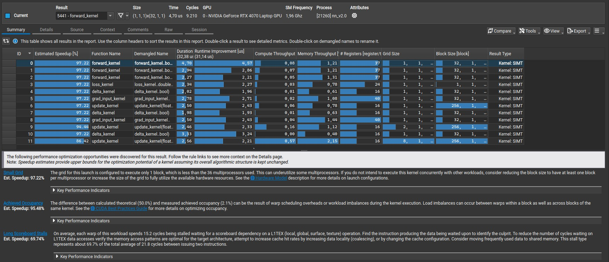

| Kernel (grade × bloco) | Ocupação teórica | Ocupação alcançada | Ciclos por instrução emitida | Espera por memória global (`long_scoreboard`) |
|:---|---:|---:|---:|---:|
| `forward_kernel`, camada 1 (1 × 32) | 50% | 2.1% | 21.8 | 15.2 |
| `delta_kernel` (1 × 32) | 50% | 1.9 a 2.1% | 63 a 64 | 21.4 a 22.5 |
| `grad_input_kernel` (1 × 32) | 50% | 2.2% | 23.4 a 29.5 | 9.1 a 16.1 |
| `update_kernel` (1, 2 e 8 × 256) | 100% | 12.8 a 16.9% | 36.9 a 41.0 | 15.6 a 19.3 |

- **A ocupação teórica de 100% só vale para os kernels de 256 threads.** Nos de um warp por bloco, o limite de 24 blocos por SM do Ada deixa no máximo 24 de 48 warps (50%). A alcançada é de ~2%: um warp no único SM que recebe o bloco.
- **Cada kernel passa a maior parte do tempo esperando a memória global.** Um warp emite uma instrução a cada 17 a 64 ciclos, e a maior parcela é `long_scoreboard`: cada kernel começa lendo da memória global o que o anterior escreveu.
- **O acesso não coalescido ficou medido:** no `forward_kernel` da camada 1, 16.4 setores de 32 B por requisição (2 116 em 129), contra 4 de um acesso coalescido. É a média entre `x[j]`, igual para o warp inteiro (1 setor), e `W[i][j]`, com passo de uma linha por thread (32 setores).

### Uma GPU de datacenter não resolve um gargalo de lançamento

Na V100 do Santos Dumont o porte levou 5.35 s. A razão entre os tempos do Santos Dumont e do notebook (1.34) é a razão entre os clocks das **CPUs** que fazem os lançamentos (5.1/3.7 = 1.38), não das GPUs. No Franky, a RTX A1000 (a GPU mais fraca, mas com um i9 a 5.5 GHz lançando) ficou perto do notebook.

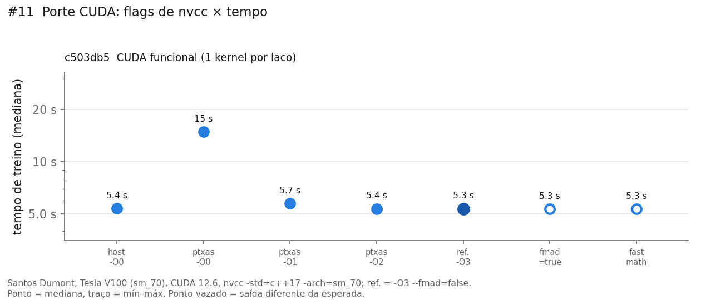

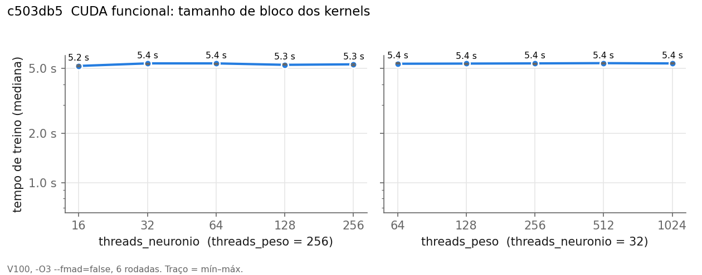

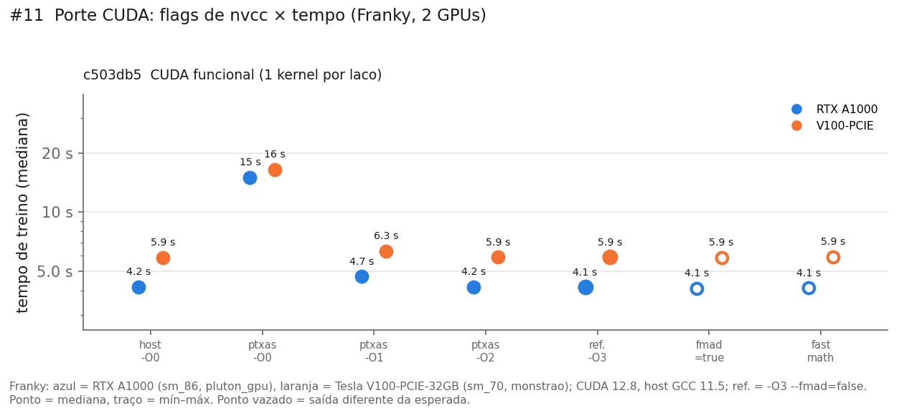

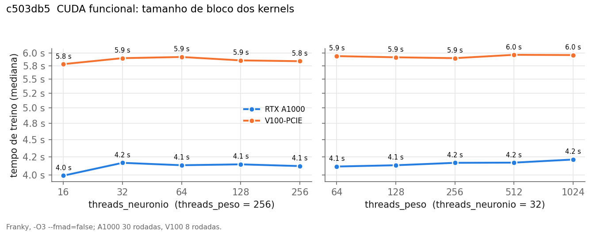

Nada que muda o trabalho dentro do kernel muda o tempo: tamanho de bloco indiferente (±4%), host em `-O0` sem efeito. A única flag que pesa é `-Xptxas -O0` (2.8x a 3.6x), porque deixa cada kernel mais longo que o próprio lançamento. O caminho estava claro: **cortar lançamentos**.

---

## 10. Etapa 5 · Otimização da execução em GPU (Issue #13)

### Diagnóstico e plano

O SGD com uma amostra por passo cabe num **único bloco**. O caminho era tirar o host e a memória global do caminho crítico de cada amostra. A Issue listou cinco otimizações, cada uma num commit, e uma expectativa honesta: "mesmo com tudo isso, a GPU deve continuar no patamar da CPU".

O critério de corretude foi combinado antes: as otimizações 1, 2, 3 e 5 mantêm a saída bit a bit; a 4 (redução por *shuffle*) muda a ordem das somas e precisa ficar dentro de ±0.1 p.p. de acurácia e ±0.001 de perda.

### Resultado (notebook, 10 rodadas intercaladas)

| # | Otimização | Tempo | Por amostra | Ganho | Acumulado | vs. CPU |
|:---:|:---|---:|---:|---:|---:|:---|
| – | `v2.0` (base) | 3.982 s | 20.42 µs | – | 1.0x | 18.0x mais lento |
| 1 | Fusão: um kernel por amostra (`e44b150`) | 1.137 s | 5.83 µs | 3.50x | 3.5x | 5.1x mais lento |
| 2 | Kernel persistente por época, pesos na memória compartilhada (`b4f0a00`) | 0.366 s | 1.88 µs | 3.11x | 10.9x | 1.65x mais lento |
| 3 | Dimensões em tempo de compilação (`c1b2601`) | 0.302 s | 1.55 µs | 1.21x | 13.2x | 1.37x mais lento |
| 4 | Produtos escalares por warp com `__shfl_xor_sync` (`261c336`) | 0.292 s | 1.50 µs | 1.04x | 13.6x | 1.32x mais lento |
| 5 | Imagens em blocos de 128 na memória compartilhada (`0ae7642`) | **0.266 s** | **1.36 µs** | 1.10x | **15.0x** | 1.20x mais lento |

Acurácia 95.5% em todas; perda de teste 0.0434 a partir da 4 (critério cumprido). `memcheck`, `racecheck` e `synccheck` limpos em todas.

A diferença aparece nítida no Nsight Systems. Antes, 12 kernels curtos por amostra e a CPU presa em `cudaLaunchKernel`:

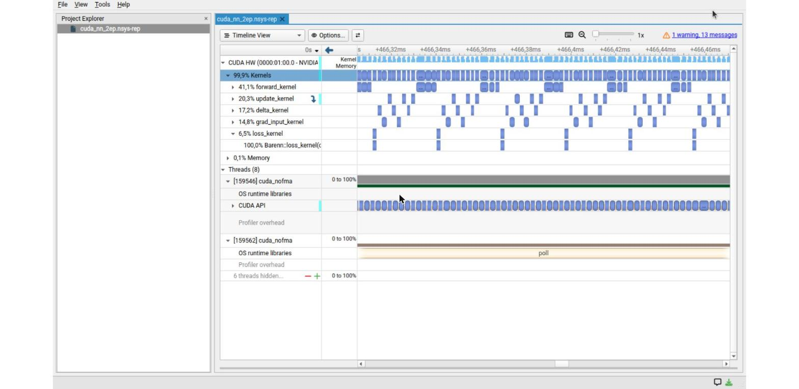

Depois, 51 kernels `train_epoch_kernel` encostados um no outro e a CPU numa única chamada de `cudaDeviceSynchronize`:

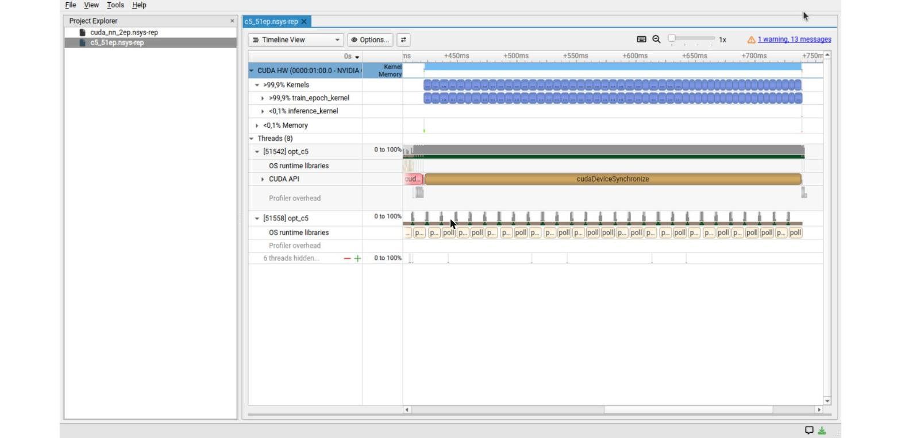

### O que cada passo ensinou

- **Fusão e kernel persistente** foram os dois grandes saltos: 2.34 milhões → 51 lançamentos. A folga de uma posição por linha contra conflito de banco valeu só 3%, porque a cadeia de somas já esperava cada leitura.
- **Dimensões em tempo de compilação** permitiram ao compilador desenrolar a atualização e emitir as 8 leituras juntas (ganho dentro da faixa prevista de 10–20%).
- **A interação entre as otimizações 4 e 5** foi o achado mais interessante: aplicar os blocos de imagens antes dos *shuffles* rendia só 1.7%; depois, 9%. Quando o cálculo encurtou, a latência da leitura da imagem passou a pesar.
- **Tentativas descartadas, medidas:** concentrar o caminho crítico num warp com `__syncwarp()` ficou 6% mais lento. Com 1 024 threads o kernel nem lança (70 registradores × 1 024 > 65 536).

### Onde ficou o tempo

Com o `ncu` bloqueado durante o bloco, uma ablação (retirar uma etapa por vez) localizou o caminho crítico: a atualização dos pesos responde por ~39% do tempo, o `Forward` por ~33%, e só as 11 barreiras por amostra já custam 0.033 s (~12%).

- **Roofline:** 11.1 GFLOP/s, 2.2% do pico de **um** SM. Cada amostra traz da memória global só 260 B. O limite é a **latência** de uma cadeia de etapas dependentes executada por um bloco.
- **Amdahl:** a sequência de amostras é serial; usar os 36 SMs exigiria minilotes, que mudam a saída.

### O que o Nsight Compute confirmou

Perfil de uma época da `v2.1` com `sudo ncu --set full`, com o SM travado em 1.98 GHz.

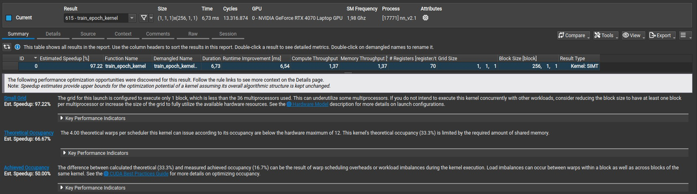

| Métrica (`train_epoch_kernel`, uma época) | `v2.1` |
|:---|---:|
| Ciclos do SM por época | 13.32 M (3 483 por amostra) |
| Registradores / memória compartilhada por bloco | 70 / 45 472 B |
| Ocupação teórica (limitada pela memória compartilhada, 2 blocos por SM) | 33.3% (16 de 48 warps) |
| **Ocupação alcançada** | **16.7% (8 warps: o único bloco)** |
| Ciclos ativos por SM, média dos 36 SMs | 369 856 (= 13.32 M ÷ 36) |
| Warps parados por instrução emitida: `short_scoreboard` / barreira / `wait` / `long_scoreboard` | 3.92 / 2.60 / 1.79 / 0.13 |

- **A ocupação calculada estava certa.** Teórica de 33.3% e alcançada de 16.7%, exatamente os 8 warps do único bloco. A média de ciclos ativos por SM é 1/36 dos ciclos do kernel: só um SM trabalha.
- **Os 13.32 M ciclos batem com o `clock64`** usado na Etapa 6 (13.2 a 13.7 M por época).
- **O gargalo mudou de lugar.** No porte funcional dominava a espera pela memória global (`long_scoreboard` de 5 a 22); aqui ela cai para 0.13. Dominam agora `short_scoreboard` (resultado de um acesso à memória compartilhada ou de um *shuffle*) e a barreira: a latência da cadeia de etapas dentro do SM, que a ablação havia apontado.
- **Conflitos de banco medidos:** as leituras de 4 bytes da memória compartilhada geram 21% de *wavefronts* acima do ideal (363 mil por época). A maior parte vem do conflito de 2 vias no `Forward` da camada 1, que a Etapa 6 corrige: com as leituras em `float4` alternado, o excesso cai para 99 mil.

### Reprodução nas GPUs de datacenter

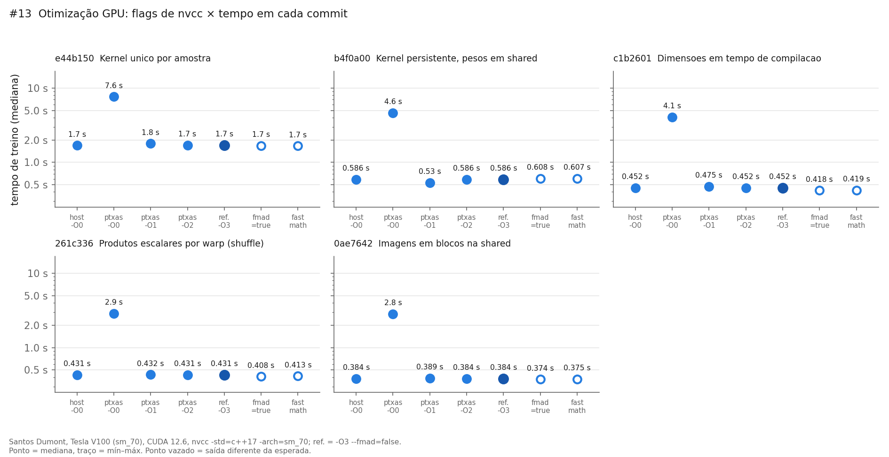

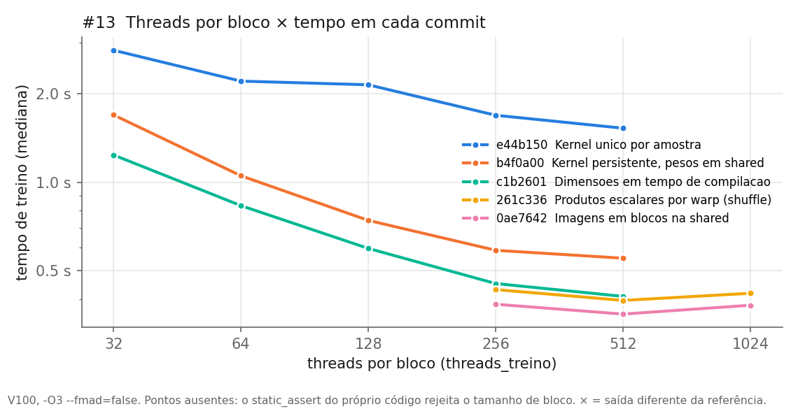

Todas as otimizações se reproduzem, na mesma ordem e com tamanhos parecidos (13.9x na V100-SXM2, 13.6x na V100-PCIE, 11.7x na A1000). Na V100, a `v2.1` já é 1.28x mais rápida que o Xeon do mesmo nó. Sem lançamentos no caminho, `-Xptxas -O0` passa a custar de 4.5x a 9.0x: agora o tempo é o código de máquina do kernel. E o tamanho de bloco ótimo passou a depender da GPU: 256 no Ada, 512 no Volta e no Ampere.

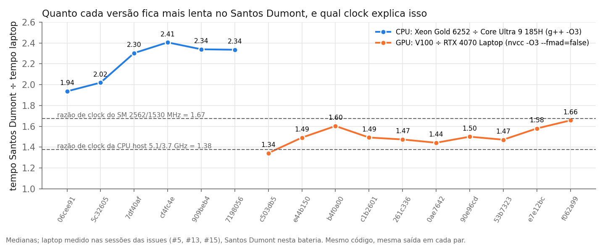

Esse gráfico mostra o gargalo mudando de lugar: no porte funcional, a razão V100 ÷ notebook segue o clock das CPUs; depois da fusão, ela se aproxima da razão dos clocks dos SMs (2 562 / 1 530 = 1.67).

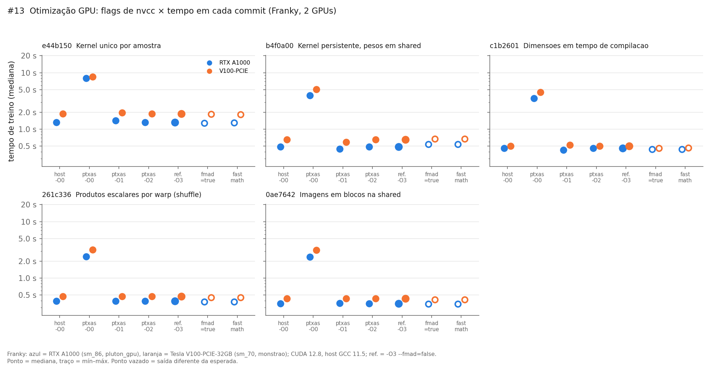

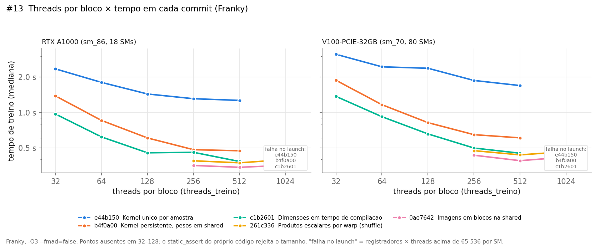

---

## 11. Etapa 6 · Pipelining dentro do kernel (Issue #15)

### Diagnóstico

Na `v2.1` não sobrava nada fora do kernel: os intervalos entre os 51 kernels somavam 37 µs. Cronometrando dentro do kernel com `clock64()`, apareceu um detalhe metodológico importante: **o SM roda a 1 980 ou 2 577 MHz conforme o aquecimento, mas toda época leva ~13.4 milhões de ciclos** (~3 500 por amostra). Desde então, **ciclos por amostra** passaram a ser a métrica estável, independente do clock.

A cronometragem por etapa mostrou onde estavam os ciclos: atualização dos pesos da camada 1 (24%), `Forward` da camada 1 (21%), e 11 barreiras separando etapas que nem sempre dependiam uma da outra. Os mesmos 2 048 pesos da camada 1 eram percorridos duas vezes por amostra, e a cópia do bloco de imagens parava todas as threads a cada 128 amostras.

### Hipótese

Encurtar a cadeia de cada amostra **sem mudar nenhuma conta**: mesmas operações, mesmos operandos, mesma ordem de soma. Só muda qual thread faz cada operação e em que etapa. Critério: saída idêntica bit a bit à `v2.1`.

### Resultado (notebook)

| # | Otimização | Tempo | Ciclos/amostra | Ganho | vs. CPU |
|:---:|:---|---:|---:|---:|:---|
| – | `v2.1` (base) | 0.2661 s | 3 540 | – | 1.24x mais lento |
| 1 | `grad_in` e atualização fundidos, 11 → 6 barreiras (`90e96cd`) | 0.2171 s | ~2 866 | 1.23x | empate |
| 2 | Cópia assíncrona com `cp.async` e buffer duplo (`53b7323`) | 0.2155 s | 2 833 | 1.007x | empate |
| 3 | Atualização da camada 1 no `Forward` da amostra seguinte (`e7e12bc`) | 0.1758 s | 2 290 | 1.23x | 1.22x mais rápido |
| 4 | Leituras `float4` sem conflito de banco (`f062a99`) | **0.1611 s** | **2 161** | 1.09x | **1.33x mais rápido** |

**Saída idêntica bit a bit à `v2.1` em todas as rodadas.** Pela primeira vez, a GPU passou a CPU.

### O que cada passo ensinou

- **Fundir etapas do `Backward`:** a thread que lê `W[i][j]` para o `grad_in` usa o valor antigo e já escreve o novo; a perda saiu do caminho crítico (um warp ocioso a calcula em paralelo). −19% de ciclos, perto do previsto.
- **`cp.async`:** o ganho foi pequeno, como previsto, porque a parada já era amortizada em 128 amostras. O detalhe interessante foi **onde pedir a cópia**: pedi-la no início da amostra deixou o treino 2% mais lento; depois do `Forward` da camada 1 foi o melhor ponto.
- ***Pipelining* entre amostras:** a atualização dos pesos da camada 1 da amostra `k` é feita dentro do `Forward` da amostra `k+1`. As duas etapas mais caras (826 + 706 ciclos) viraram uma de ~666. Isso não quebra a dependência do SGD: só adia a escrita para o momento em que o peso é lido de novo, sem mudar nenhuma conta.
- **`float4` com ordem alternada:** separando os efeitos, a leitura vetorizada vale ~2.4% e eliminar o conflito de banco de 2 vias vale mais ~6%.

O kernel passou de 70 para 54 registradores por thread, e a GPU subiu de 11.1 para 18.3 GFLOP/s (a CPU faz 13.8).

### `v2.1` × `v2.2` no Nsight Compute

Uma época de cada versão com `sudo ncu --set full`, SM travado em 1.98 GHz:

| Métrica (`train_epoch_kernel`, uma época) | `v2.1` | `v2.2` | Variação |
|:---|---:|---:|---:|
| Ciclos do SM por época | 13.32 M | 8.04 M | −40% |
| Instruções executadas (por warp) | 9.97 M | 7.78 M | −22% |
| Ciclos por instrução emitida, por warp | 10.49 | 8.25 | −21% |
| Warps elegíveis por escalonador | 0.20 | 0.30 | +50% |
| Espera `short_scoreboard` (memória compartilhada, *shuffle*) | 3.92 | 2.89 | −26% |
| Espera em barreira (`__syncthreads`) | 2.60 | 2.07 | −20% |
| Espera `long_scoreboard` (memória global) | 0.13 | 0.02 | |
| *Wavefronts* da memória compartilhada | 3.52 M | 2.21 M | −37% |
| *Wavefronts* em excesso por conflito de banco | 627 mil | 424 mil | −32% |
| Eficiência de desvio | 89.7% | 99.3% | |
| Ocupação teórica / alcançada | 33.3% / 16.7% | 33.3% / 16.7% | |

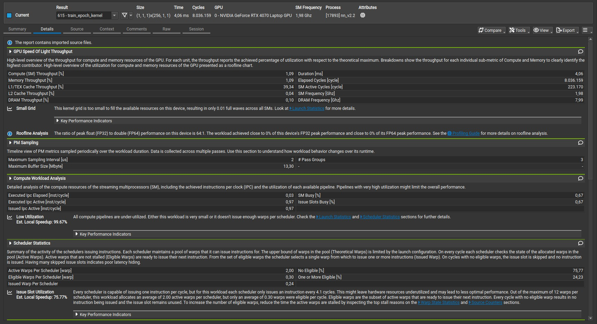

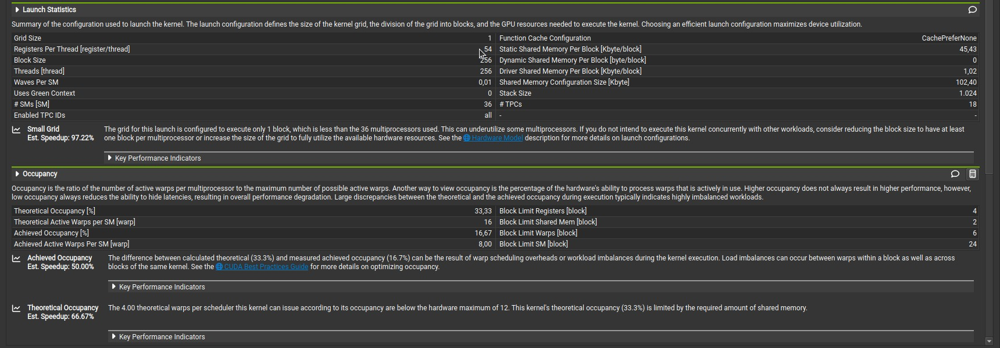

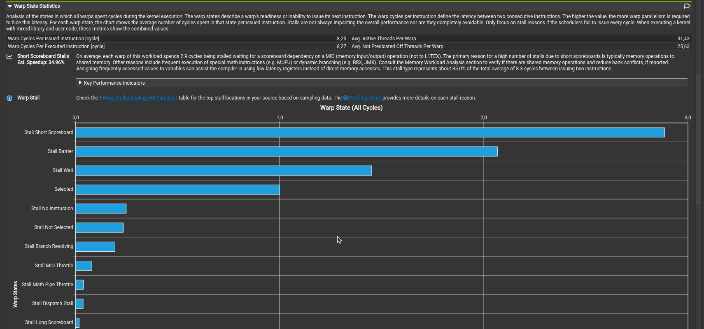

- **Os ciclos confirmam o `clock64`:** 8.04 M por época no `ncu`, contra 8.26 M medidos dentro do kernel; ~2 100 ciclos por amostra.
- **O ganho veio de encurtar as esperas, não de mais paralelismo.** A ocupação é a mesma (um bloco de 8 warps num SM; os ciclos ativos médios por SM, 223 170, são 8.04 M ÷ 36). O que muda é quanto trabalho esses warps fazem por ciclo: uma instrução a cada 8.25 ciclos (eram 10.49), com menos espera pela memória compartilhada (−26%) e pelas barreiras (−20%, de 11 para 5 por amostra).
- **As leituras `float4` em ordem alternada não têm conflito:** 741 662 *wavefronts* nas leituras `LDS.128`, todas ideais.
- **O que o `ncu` ainda aponta:** as escritas `STS.128` dos pesos novos da camada 1 levam 4 *wavefronts* por instrução, como as leituras, mas o `ncu` considera 2 o ideal para escritas e conta 64 *wavefronts* de excesso por amostra. Mesmo no caminho crítico, isso valeria no máximo ~3% dos ~2 100 ciclos. As regras *Small Grid* e *Issue Slot Utilization* pedem mais warps por SM, ou seja, minilotes, que mudam a saída.

### A versão final é limitada pelo clock de um SM

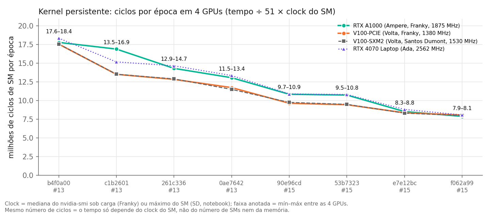

Este é, talvez, o gráfico mais revelador do projeto. Na `v2.1`, o Volta precisava de ~11.7 M ciclos por época, e Ampere e Ada de ~13.2 M. Na `v2.2`, **as quatro GPUs convergem para 7.9 a 8.1 M ciclos por época**: o *pipelining* eliminou exatamente o que Ampere e Ada pagavam a mais. Com o mesmo número de ciclos em todas, o tempo passa a depender só do clock do SM:

- a V100-PCIE (80 SMs, HBM2) é **mais lenta que a RTX A1000** (18 SMs), e a razão dos tempos (1.39) é a razão dos clocks (1.36);
- a V100-PCIE do Franky e a V100-SXM2 do Santos Dumont diferem 1.10–1.13x em todos os commits, exatamente a razão de seus clocks (1.11).

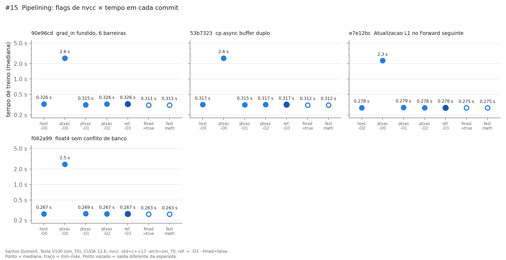

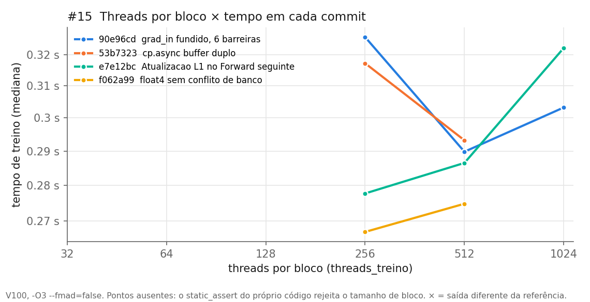

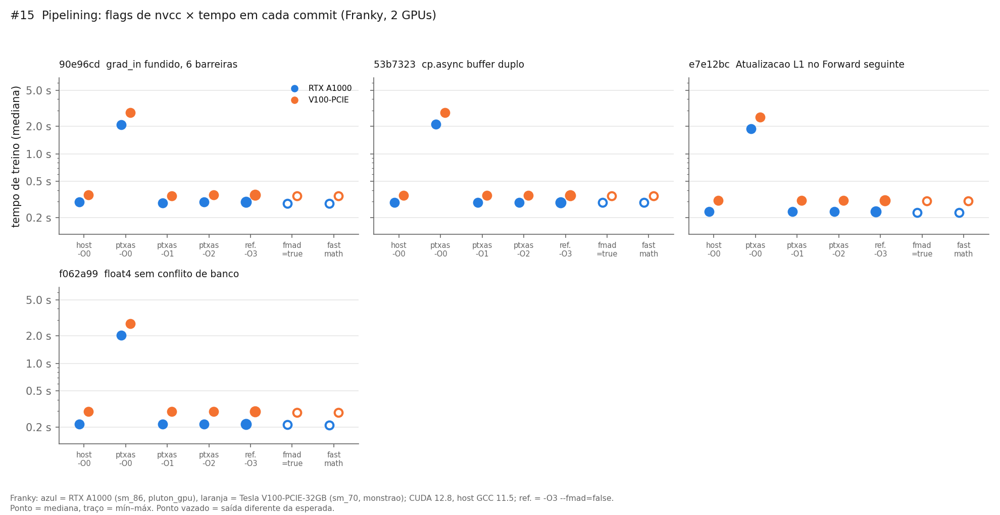

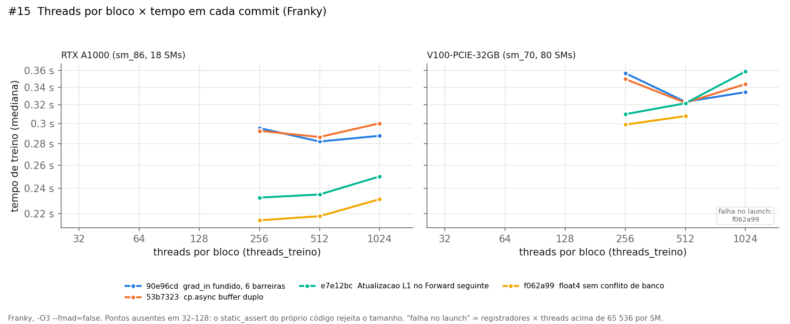

Depois que a atualização da camada 1 foi para o `Forward` seguinte, **256 threads voltou a ser o tamanho ótimo em todas as GPUs**, inclusive no Volta: o trabalho passou a ser dividido para 256 threads, e mais warps só acrescentam custo de barreira. O valor usado no código é o ótimo da versão final.

---

## 12. Reprodução em cinco máquinas

Depois de fechar o último bloco, reexecutei **todos os 34 commits** (18 versões distintas de código), sem alterar uma linha, no Santos Dumont e no Franky. Os resultados foram anexados a cada Issue. Isso testou a tag mais importante da governança: qualquer pessoa pode fazer `git checkout <tag>`, compilar e obter o mesmo comportamento.

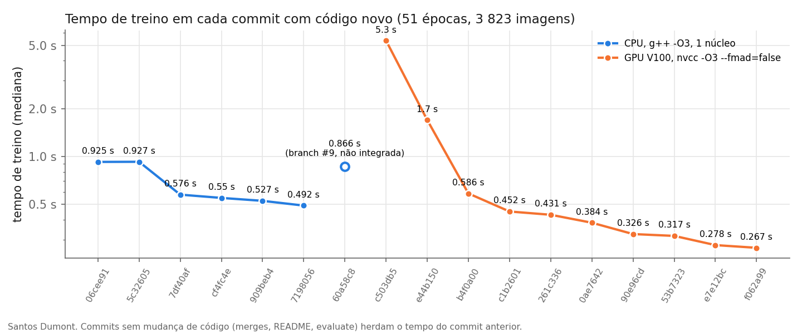

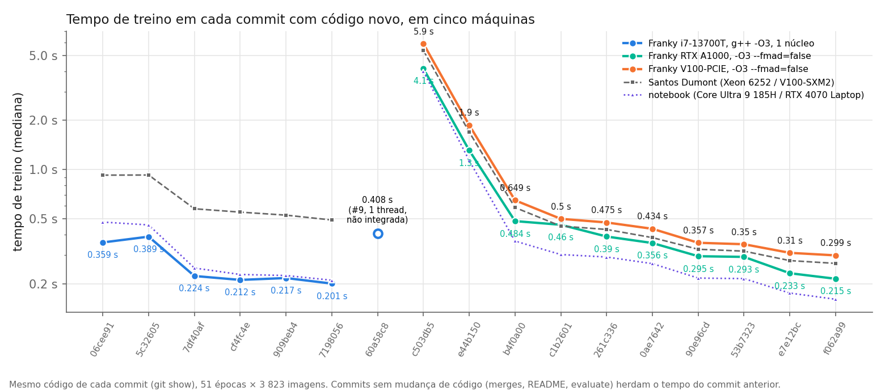

O que a reprodução mostrou:

- **A corretude é portátil.** O hash da saída do legado é o mesmo no notebook, no Santos Dumont e no Franky, e a saída CUDA é idêntica bit a bit em `sm_70`, `sm_86` e `sm_89`.
- **A ordem dos ganhos é a mesma em todas as máquinas**, embora os ajustes finos dependam da arquitetura (dimensões em tempo de compilação rendem 4.6x mais no Volta; produtos por warp, 3x mais no Ampere).
- **O ruído em nó exclusivo é baixíssimo** (coeficiente de variação de 0.01% a 0.35%), o que tornou mensuráveis diferenças de 1–2% entre commits.

### Quem vence: CPU ou GPU?

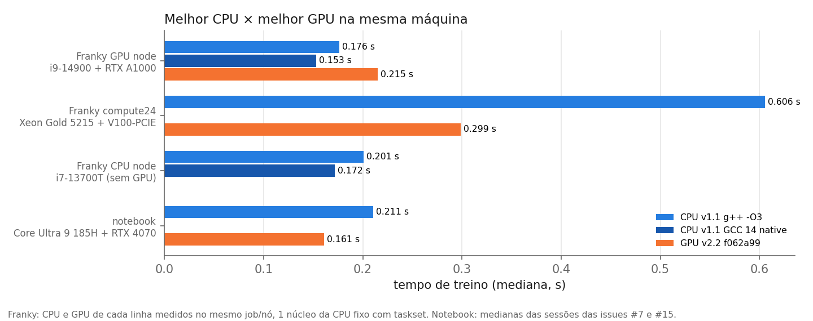

| Máquina | Melhor CPU (`v1.1`) | GPU `v2.2` | Mais rápida |
|:---|---:|---:|:---|
| Franky, nó da A1000 (i9-14900, 5.5 GHz) | 0.176 s (0.153 s com GCC 14 native) | 0.215 s | **CPU**, 1.22x a 1.41x |
| Franky, nó da V100 (Xeon Gold 5215, 3.1 GHz) | 0.606 s | 0.299 s | GPU, 2.03x |
| Santos Dumont (Xeon Gold 6252 + V100-SXM2) | 0.492 s | 0.267 s | GPU, 1.84x |
| Notebook (Core Ultra 9 + RTX 4070) | 0.211 s | 0.161 s | GPU, 1.31x |

**Quem vence depende da CPU, não da GPU.** O kernel precisa de ~8 M ciclos por época em qualquer GPU, e seu tempo é fixado pelo clock do SM (1.4 a 2.6 GHz). A versão de CPU roda na velocidade de um núcleo do host (3.1 a 5.5 GHz). Num núcleo de desktop rápido, o SGD amostra a amostra é melhor servido pela CPU.

---

## 13. Conclusões

**Sobre os números.** O treino foi de 0.478 s (legado, `-O3`) para 0.208 s na CPU (2.30x) e 0.161 s na GPU (2.97x), sem mudar o resultado do modelo. Partindo do legado sem flags (5.88 s), o ganho total é de ~36x. Dentro da GPU, do porte funcional à versão final, foram 24.7x no notebook e 20.0x na V100.

**Sobre o hardware.** Cada etapa foi explicada pelo comportamento da máquina, não só pelas linhas alteradas:

- Um modelo de ~11 KB vive inteiro na L1, então otimizar layout de memória rendeu pouco, e o que rendeu foi deixar o compilador vetorizar. O roofline colocou o código, desde o início, do lado limitado por cálculo.
- O paralelismo em CPU foi derrotado pela Lei de Amdahl *com custo de sincronização*: barreiras de 0.1 a 1.7 µs contra 0.15 µs de trabalho. Os contadores de coerência (HITM) e o `futex` por barreira mostraram o mecanismo.
- Na GPU, o gargalo mudou de lugar três vezes, e cada mudança foi medida: primeiro a latência de lançamento (o tempo seguia o clock da CPU); depois a cadeia de etapas dentro de um SM (o tempo seguia o clock do SM); e no fim um número fixo de ciclos por época, igual em três arquiteturas. O Nsight Compute mostrou a mesma história nos motivos de espera dos warps: no porte funcional dominava a espera pela memória global (`long_scoreboard`); no kernel persistente, a espera pela memória compartilhada e pelas barreiras, que o *pipelining* reduziu em 20% a 26%. A ocupação alcançada (2% no porte, 16.7% depois, sempre um bloco) bateu com o calculado.
- O PCIe nunca foi o gargalo: os dados sobem uma vez (0.8 ms) e nada trafega durante o treino.

**Sobre as decisões de engenharia.**

- Mantive `-Ofast`, `--use_fast_math`, `--fmad=true` e `-march=native` fora das versões oficiais, mesmo quando eram mais rápidos, porque mudam a saída. A única mudança de ordem de soma aceita (*shuffles*) teve critério combinado antes, na Issue.
- Recusei o merge do OpenMP porque os dados o refutaram, e documentei o porquê em três máquinas.
- Não adotei minilotes. Eles destravariam os outros 35 SMs da GPU e os outros núcleos da CPU, mas mudam o algoritmo e o resultado. Sem um critério de validação combinado, isso violaria a regra central do projeto.

**Sobre o processo.** A ferramenta de medição da primeira semana se pagou várias vezes: pegou o `-Ofast` mudando a saída, mostrou que uma execução por nível não bastava e permitiu reproduzir todos os commits em cinco máquinas. As hipóteses escritas antes do código serviram de régua: várias previsões bateram (porte ~20x mais lento, ganho modesto das alocações, `cp.async` ~1%), e as que não bateram (o *shuffle* rendeu menos que o previsto, `-O2` não ganhou com os buffers) foram as que mais ensinaram.

---

## 14. Apêndice: índice, tags e reprodução

### Índice de Issues, PRs e tags

| Bloco | Issue | PR | Tag | Commit |
|:---|:---|:---|:---|:---|
| Ferramenta `evaluate` | [#1](https://github.com/GabrielGalazzi/awful-barenn-Gabriel-Galazzi/issues/1) | [#2](https://github.com/GabrielGalazzi/awful-barenn-Gabriel-Galazzi/pull/2), [#3](https://github.com/GabrielGalazzi/awful-barenn-Gabriel-Galazzi/pull/3), [#4](https://github.com/GabrielGalazzi/awful-barenn-Gabriel-Galazzi/pull/4) | [`v0.0-ferramenta-evaluate`](https://github.com/GabrielGalazzi/awful-barenn-Gabriel-Galazzi/tree/v0.0-ferramenta-evaluate) | `403d616` |
| Métrica base | [#1](https://github.com/GabrielGalazzi/awful-barenn-Gabriel-Galazzi/issues/1), [#5](https://github.com/GabrielGalazzi/awful-barenn-Gabriel-Galazzi/issues/5) | – | [`v0.1-Baseline-Data`](https://github.com/GabrielGalazzi/awful-barenn-Gabriel-Galazzi/tree/v0.1-Baseline-Data) | `2d2597f` |
| Otimizações básicas | [#5](https://github.com/GabrielGalazzi/awful-barenn-Gabriel-Galazzi/issues/5) | [#6](https://github.com/GabrielGalazzi/awful-barenn-Gabriel-Galazzi/pull/6) | [`v1.0-Otimizacoe-Basicas-Aplicadas`](https://github.com/GabrielGalazzi/awful-barenn-Gabriel-Galazzi/tree/v1.0-Otimizacoe-Basicas-Aplicadas) | `909beb4` |
| Buffers reutilizáveis | [#7](https://github.com/GabrielGalazzi/awful-barenn-Gabriel-Galazzi/issues/7) | [#8](https://github.com/GabrielGalazzi/awful-barenn-Gabriel-Galazzi/pull/8) | [`v1.1-Buffers-Reutilizaveis`](https://github.com/GabrielGalazzi/awful-barenn-Gabriel-Galazzi/tree/v1.1-Buffers-Reutilizaveis) | `7198056` |
| OpenMP (refutado) | [#9](https://github.com/GabrielGalazzi/awful-barenn-Gabriel-Galazzi/issues/9) | [#10](https://github.com/GabrielGalazzi/awful-barenn-Gabriel-Galazzi/pull/10) (sem merge) | – | `60a58c8` |
| Porte CUDA | [#11](https://github.com/GabrielGalazzi/awful-barenn-Gabriel-Galazzi/issues/11) | [#12](https://github.com/GabrielGalazzi/awful-barenn-Gabriel-Galazzi/pull/12) | [`v2.0-CUDA-Funcional`](https://github.com/GabrielGalazzi/awful-barenn-Gabriel-Galazzi/tree/v2.0-CUDA-Funcional) | `5a65c8b` |
| CUDA otimizado | [#13](https://github.com/GabrielGalazzi/awful-barenn-Gabriel-Galazzi/issues/13) | [#14](https://github.com/GabrielGalazzi/awful-barenn-Gabriel-Galazzi/pull/14) | [`v2.1-CUDA-Otimizado`](https://github.com/GabrielGalazzi/awful-barenn-Gabriel-Galazzi/tree/v2.1-CUDA-Otimizado) | `fef5671` |
| Pipelining | [#15](https://github.com/GabrielGalazzi/awful-barenn-Gabriel-Galazzi/issues/15) | [#16](https://github.com/GabrielGalazzi/awful-barenn-Gabriel-Galazzi/pull/16) | [`v2.2-CUDA-Pipelining`](https://github.com/GabrielGalazzi/awful-barenn-Gabriel-Galazzi/tree/v2.2-CUDA-Pipelining) | `de9105b` |

### Arquivos de cada versão

| Versão | Arquivo |
|:---|:---|
| Legado | `Deprecated CPU versions/barenn.cpp` |
| `v1.0` | `Deprecated CPU versions/basic_optmization_nn.cpp` |
| `v1.1` (melhor CPU) | `reusable_buffers_nn.cpp` |
| `v2.0` | `Cuda versions/Deprecated/cuda_nn.cu` |
| `v2.1` e `v2.2` | `Cuda versions/optimized_cuda_nn.cu` |

### Como reproduzir

```bash
git checkout v2.2-CUDA-Pipelining

# CPU (melhor versão)
g++ -std=c++17 -O3 reusable_buffers_nn.cpp -o nn_cpu
taskset -c 1 ./nn_cpu optdigits.tra optdigits.tes

# GPU (ajuste -arch para a sua placa: sm_70, sm_86, sm_89...)
nvcc -O3 -std=c++17 -arch=sm_89 --fmad=false "Cuda versions/optimized_cuda_nn.cu" -o nn_gpu
./nn_gpu optdigits.tra optdigits.tes

# Triagem automática de todos os níveis, com verificação de saída
./evaluate reusable_buffers_nn.cpp relatorio.md
```

A acurácia impressa deve ser 95.5%. Para conferir a corretude, compare a saída sem as linhas que contêm "Tempo" com a da versão de referência.
